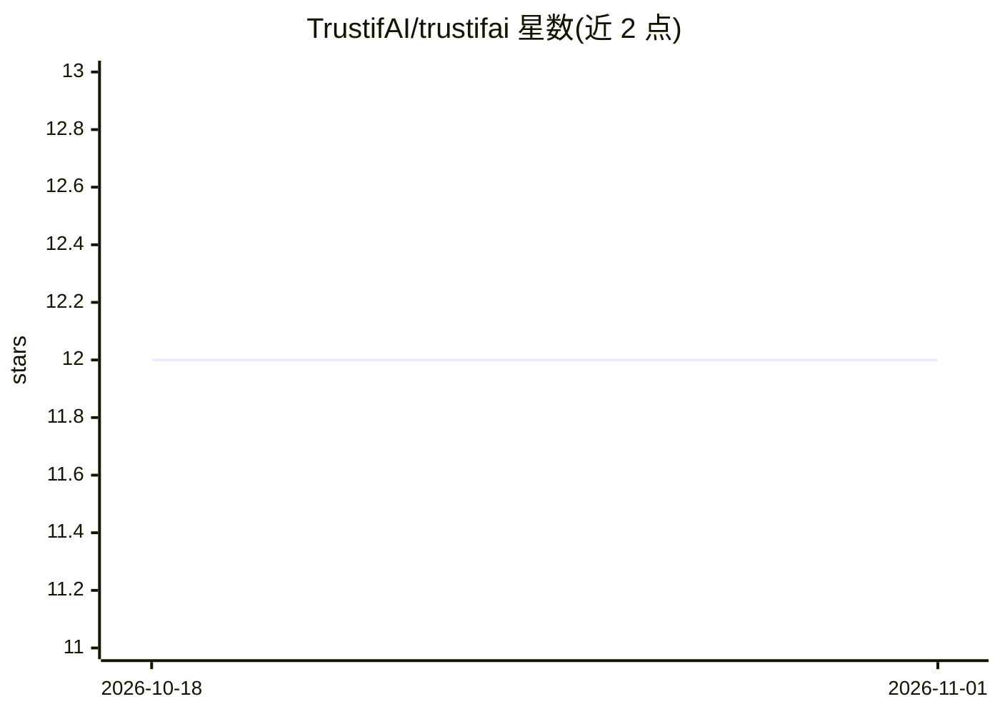

# TrustifAI/trustifai

⭐ 12 · Python · MIT · 推送 2026-06-21 · [GitHub](https://github.com/TrustifAI/trustifai) · [官网](https://mintlify.wiki/TrustifAI/trustifai) · 组织维护

**评估 LLM 回答与 RAG 系统可信度的 Python 框架**

面向开发者的可信度评估框架：对已生成的 RAG 回答计算多维 Trust Score，含 Evidence Coverage（NLI 逐句蕴含检验）、Epistemic Consistency（高温采样 k 次的语义稳定性）、Semantic Drift（与检索文档的句子级相似度）、Source Diversity（来源多样性）四类离线指标，另有基于 token logprobs 的在线 Confidence Score（仅适用于支持 logprobs 的 LLM，且对校准不足的模型可能不适用）。通过 LiteLLM 接入 OpenAI/Azure/Anthropic/Gemini/Mistral 等，支持 YAML 配置权重、自定义 BaseMetric 扩展，并以 PyVis 交互式 HTML 或 Mermaid 形式输出推理图。

## 筛选速览

| 维度 | 判定 | 备注 |
|---|---|---|
| AI 角色 | `ai-ecosystem` | LLM/agent 周边工具 |
| 许可风险 | `permissive` | MIT |
| 部署形态 | `library` | 以包/库形式分发 |
| 模型依赖 | — | README 未给出锁定关系 |
| 硬件要求 | — | 无带数字的原话,不猜 |
| 安装摩擦 | `low` | 无编译、无系统依赖或容器化 |
| 成熟度 | — | 结构信号不足 |

## 能力要点

- 四维离线指标（Evidence Coverage / Epistemic Consistency / Semantic Drift / Source Diversity）加权聚合为 Trust Score
- 基于 logprobs 的在线 Confidence Score（附适用性限制说明）
- PyVis 交互式 HTML 与 Mermaid 推理图可视化评估逻辑
- 继承 BaseMetric 注册自定义指标并以 YAML 配置权重

## 适用场景

- 对 RAG 系统的回答做幻觉与一致性检测
- 生成回答时同步获得模型置信度信号
- 以推理图向团队展示某输出被判为不可靠的原因

## 场景标签

`模型评测` · 领域:评测与运维

## 证据(README 行号)

> L4: TrustifAI is a Python-based framework designed to evaluate the trustworthiness of LLM responses and Retrieval-Augmen
> L16: **TrustifAI** evaluates trustworthiness using four orthogonal vectors or trust signals. The final *Trust Score* is 

## 星数曲线

2026-10-18 12 → 2026-11-01 12（+0）

---
*卡片 v1 · prompt 1.4 · 生成 2026-11-01 · 置信度 high · 依据 README sha `851efb189587` · [字段定义](../../DATASET.md)*
