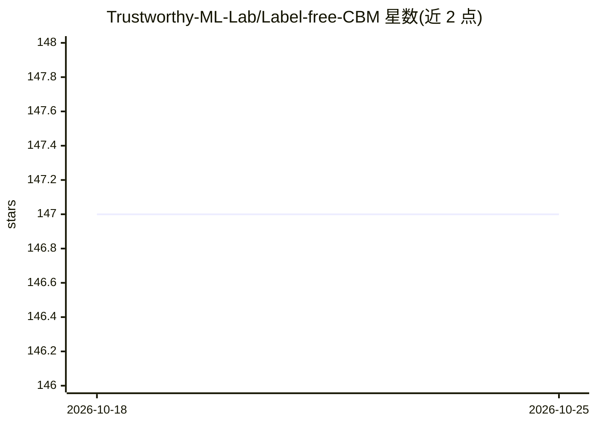

# Trustworthy-ML-Lab/Label-free-CBM

⭐ 147 · Jupyter Notebook · 推送 2026-04-07 · [GitHub](https://github.com/Trustworthy-ML-Lab/Label-free-CBM) · 组织维护

**无需概念标注即可将神经网络转为可解释概念瓶颈模型的框架**

ICLR 2023 论文 Label-free CBM 的官方代码库：提供将任意神经网络变换为概念瓶颈模型（CBM）的训练与评估流程，不依赖人工概念标注。机制上可用 GPT-3 生成初始概念集（需自备 API key，产生费用），也提供现成概念集与 ConceptNet 备选；在 CIFAR10/100、CUB200、Places365、ImageNet 五个数据集上给出与标准模型及稀疏最终层模型的精度对照。安装需 Python 3.9、PyTorch 1.13，并运行脚本下载预训练模型与数据集。

## 筛选速览

| 维度 | 判定 | 备注 |
|---|---|---|
| AI 角色 | `ai-native` | 本体是模型或模型工具 |
| 许可风险 | `none` | — |
| 部署形态 | `library` | 以包/库形式分发 |
| 模型依赖 | — | README 未给出锁定关系 |
| 硬件要求 | — | 无带数字的原话,不猜 |
| 安装摩擦 | `low` | 无编译、无系统依赖或容器化 |
| 成熟度 | — | 结构信号不足 |

## 能力要点

- 无需概念标注数据即可构造可解释 CBM
- GPT-3 生成概念集的流程（需自备 openai API key）及 ConceptNet 备选
- 覆盖 CIFAR10/100、CUB200、Places365、ImageNet 五个数据集的训练与评估
- 评估含模型精度、单决策解释条形图与最终层权重可视化

## 适用场景

- 复现 ICLR 2023 论文的 CBM 实验结果
- 为图像分类模型生成可解释的概念瓶颈表示
- 基于概念权重分析模型单条决策的解释

## 场景标签

 · 领域:机器学习可解释性/计算机视觉

## 证据(README 行号)

> L3: This is the official repository for our paper Label-Free Concept Bottleneck Models published at ICLR 2023. LF-CBM is
> L34: Evaluate the trained models by running `evaluate_cbm.ipynb`. This measures model accuracy, creates barplots explain

## 星数曲线

2026-10-18 147 → 2026-10-25 147（+0）

---
*卡片 v1 · prompt 1.4 · 生成 2026-10-22 · 置信度 mid · 依据 README sha `2e57a609e17a` · [字段定义](../../DATASET.md)*
