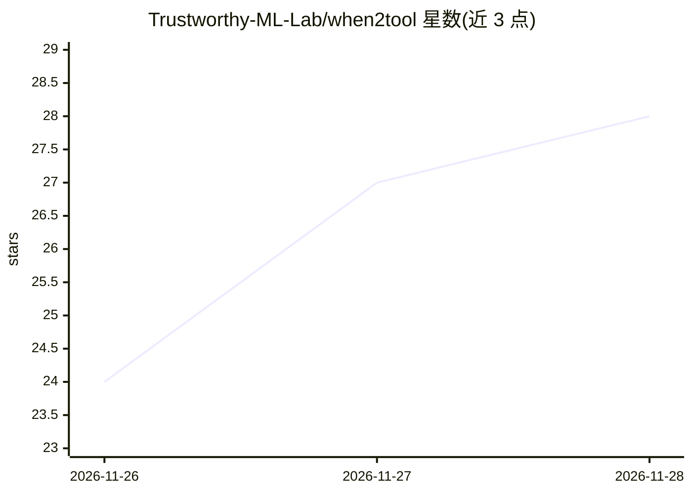

# Trustworthy-ML-Lab/when2tool

⭐ 28 · Python · 推送 2026-11-05 · [GitHub](https://github.com/Trustworthy-ML-Lab/when2tool) · [官网](https://lilywenglab.github.io/when2tool/) · 组织维护

**研究 LLM 何时需要调用工具的基准与探针框架**

NeurIPS 2026 论文的官方仓库，包含两部分：When2Tool 基准（15 个环境、单跳/多跳任务，覆盖 5 种提示模式与有/无推理两种基线）和 Probe&Prefill 方法——从模型 hidden states 训练线性探针预测工具必要性，推理时按阈值 prefill 引导句决定直接回答或调用工具。数据集托管于 HuggingFace，脚本自动下载；提供 run_pipeline.sh 一键执行评估、特征提取、探针训练、探针引导评估与绘图五步。支持 Qwen3 与 Llama 3.1/3.3 系列；Llama 模型需 hard prefill 模式。

## 筛选速览

| 维度 | 判定 | 备注 |
|---|---|---|
| AI 角色 | `ai-knowledge` | 知识聚合/清单类 |
| 许可风险 | `none` | — |
| 部署形态 | `library` | 以包/库形式分发 |
| 模型依赖 | — | README 未给出锁定关系 |
| 硬件要求 | — | 无带数字的原话,不猜 |
| 安装摩擦 | `low` | 无编译、无系统依赖或容器化 |
| 成熟度 | — | 结构信号不足 |

## 能力要点

- hidden states 线性探针预测工具必要性（AUROC 0.89–0.96）
- Probe&Prefill 推理时按阈值 prefill 引导句，减少 38% 工具调用
- run_pipeline.sh 一键五步流水线，可按 --steps 选择执行
- 数据集自动从 HuggingFace 下载，无需手动配置

## 适用场景

- 研究 LLM agent 的工具调用决策机制
- 在 Qwen/Llama 模型上复现工具必要性探针实验
- 评估不同提示与推理模式下 agent 的工具调用行为

## 场景标签

`模型评测` `科研工具` · 领域:评测与运维

## 证据(README 行号)

> L11: Tool-augmented LLM agents tend to call tools indiscriminately, even when the model can answer directly. We design *
> L30: Our benchmark **When2Tool** is available on HuggingFace: cesun/When2Tool.

## 星数曲线

2026-11-26 24 → 2026-11-28 28（+4）

---
*卡片 v1 · prompt 1.4 · 生成 2026-11-26 · 置信度 high · 依据 README sha `5360ba0b0e21` · [字段定义](../../DATASET.md)*
