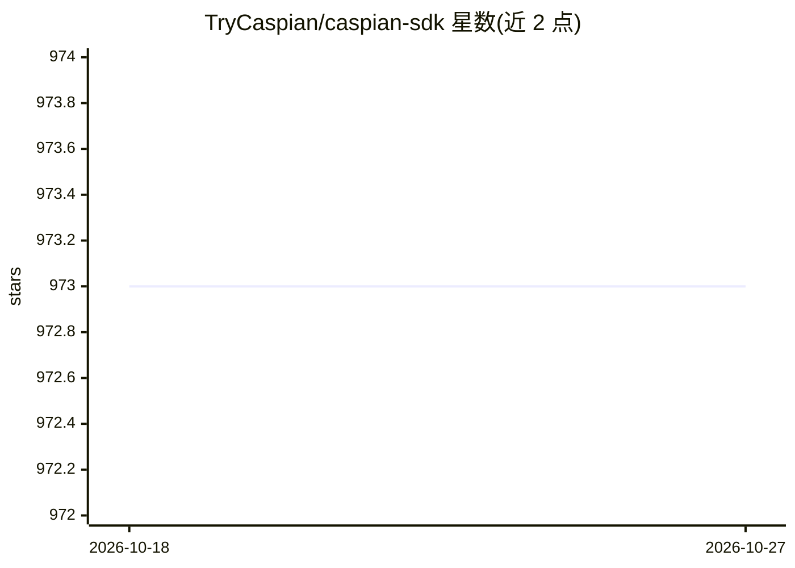

# TryCaspian/caspian-sdk

⭐ 973 · Python · AGPL-3.0 · 推送 2026-08-25 · [GitHub](https://github.com/TryCaspian/caspian-sdk) · [官网](https://trycaspianai.com) · 组织维护 · 中文 README

**AI agent 多渠道通信 SDK：一套代码接入邮件/Slack/Discord 等**

面向 AI agent 开发者的通信层 SDK，提供 Python 与 TypeScript 客户端。通过统一的 channels.add() 与 @on_message 声明式规则，让同一 agent 以单一身份在 Telegram、email、Slack、Discord、WhatsApp、X、Linear 等渠道收发消息，消息归一化为 Thread/Message 模型，并处理 webhook 验证、线程、流式回复与平台差异。支持托管网关与自托管（自带平台 token）两种模式，代码不变。限制：X API 需付费订阅，GSM 短信需自备调制解调器。

## 筛选速览

| 维度 | 判定 | 备注 |
|---|---|---|
| AI 角色 | `ai-ecosystem` | LLM/agent 周边工具 |
| 许可风险 | `viral` | AGPL-3.0 |
| 部署形态 | `library` | 以包/库形式分发 |
| 模型依赖 | — | README 未给出锁定关系 |
| 硬件要求 | — | 无带数字的原话,不猜 |
| 安装摩擦 | `low` | 无编译、无系统依赖或容器化 |
| 成熟度 | — | 结构信号不足 |

## 能力要点

- 一套 handler 覆盖 Telegram/email/Slack/Discord/WhatsApp/X/iMessage 等多渠道
- 托管（Caspian 网关）与自托管（自带 token）两种模式，handler 代码不变
- 声明式规则（cx.app.rules 为可检查数据）+ 各平台真实 payload 形状的离线 fake（650+ 测试）
- 提供 Python、TypeScript SDK 与 Bun CLI（init/channels add/call/threads tail）

## 适用场景

- 客服 agent 在客户开线的邮件、Slack、Instagram DM 上继续对话并转人工
- 个人助理类 agent 以同一身份跨我的邮箱、Telegram、Slack 工作
- 社区/产品 bot 同时驻留 Discord 与 Slack 社区

## 场景标签

`Agent 框架` · 领域:Agent 开发

## 证据(README 行号)

> L29: Caspian is an **agent communication** SDK. Your agent's reasoning decides **what** to say; Caspian is **how it exis
> L134: ## Caspian's answer

## 星数曲线

2026-10-18 973 → 2026-10-27 973（+0）

---
*卡片 v1 · prompt 1.4 · 生成 2026-10-21 · 置信度 high · 依据 README sha `bf75472035ca` · [字段定义](../../DATASET.md)*
