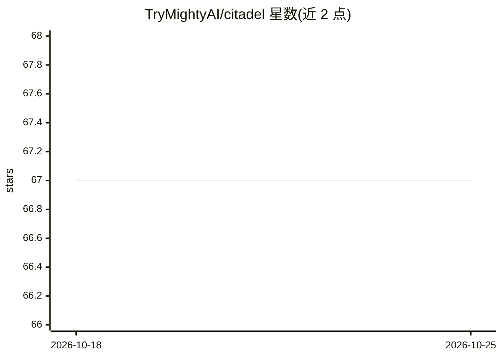

# TryMightyAI/citadel

⭐ 67 · Go · Apache-2.0 · 推送 2026-02-11 · [GitHub](https://github.com/TryMightyAI/citadel) · [官网](https://trymighty.ai) · 组织维护

**本地部署的 AI 文本安全防护网关：检测提示注入与输出风险**

面向 LLM 应用的安全过滤层，检测提示注入攻击。输入扫描采用多层流水线：启发式规则（约2ms）+ ModernBERT 分类（约15ms）+ 语义相似度匹配 229 种攻击模式，可选 LLM 裁决层（OpenRouter/Groq/Ollama/Cerebras）；输出扫描用 195+ 编译正则检测凭据泄露、间接注入、路径穿越等 8 类威胁。支持多轮攻击模式检测（Skeleton Key、Crescendo 等 6 种 OSS 模式）与 MCP 代理模式。全程本地运行，无 API 调用必需；缺组件时可降级到启发式（约70%检出）。以 Go 构建，另有 Citadel Pro 扩展（LLM Judge、Redis 会话存储等）。

## 筛选速览

| 维度 | 判定 | 备注 |
|---|---|---|
| AI 角色 | `ai-ecosystem` | LLM/agent 周边工具 |
| 许可风险 | `permissive` | Apache-2.0 |
| 部署形态 | `library` | 以包/库形式分发 |
| 模型依赖 | local-ok | 支持本地模型 |
| 硬件要求 | — | 无带数字的原话,不猜 |
| 安装摩擦 | `low` | 无编译、无系统依赖或容器化 |
| 成熟度 | — | 结构信号不足 |

## 能力要点

- 多层检测流水线：启发式 + ModernBERT + 语义相似度 + 可选 LLM 层
- 输出扫描用 195+ 编译正则覆盖 8 类威胁（凭据/注入/渗出等），<1ms
- 6 种多轮攻击模式检测（Skeleton Key/Crescendo/Boiling Frog 等）
- MCP 代理模式可置于 Claude Desktop 与 MCP 服务器之间扫描消息

## 适用场景

- 在 LLM 应用前拦截提示注入与越狱攻击
- 扫描 LLM 输出防止凭据泄露与间接注入
- 为 MCP 服务器加一层安全代理
- 检测跨多轮对话的渐进式操纵攻击

## 场景标签

`网络安全` · 领域:学习与行业

## 证据(README 行号)

> L3: A fast, flexible text guard for AI security. Detects prompt injection attacks using multi-layer detection.
> L192: Citadel is designed to run as a sidecar or filter server in front of your LLM application. Before sending user inp
> L323: Protect any MCP server. Citadel sits between Claude Desktop and your MCP server, scanning all messages.

## 星数曲线

2026-10-18 67 → 2026-10-25 67（+0）

---
*卡片 v1 · prompt 1.4 · 生成 2026-10-24 · 置信度 mid · 依据 README sha `56ba0dad8579` · [字段定义](../../DATASET.md)*
