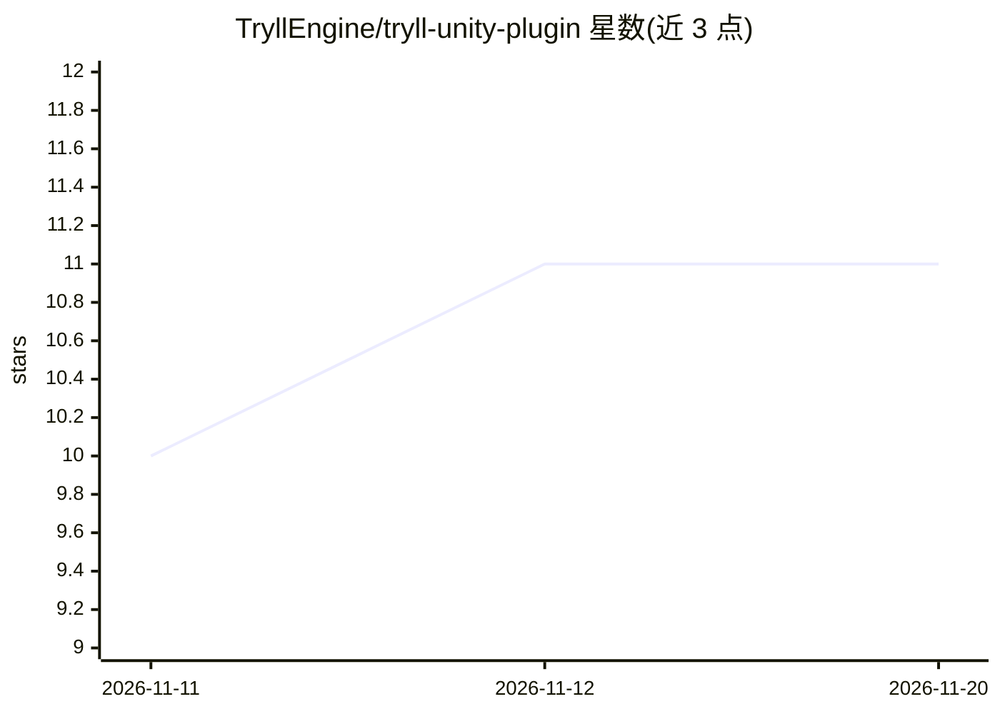

# TryllEngine/tryll-unity-plugin

⭐ 11 · C# · NOASSERTION · 推送 2026-11-10 · [GitHub](https://github.com/TryllEngine/tryll-unity-plugin) · [官网](https://www.tryllengine.com) · 组织维护

**Unity 插件：在玩家本机运行 LLM 与语音模型驱动游戏 NPC**

Tryll for Unity 是 Unity 包 com.tryll.client（0.10.2），通过 Package Manager 的 git URL 安装，配套一个按版本下载、本机共享的 Windows-only 服务器，在玩家机器上运行语言、语音转文本与文本生成语音模型，并以工作流驱动的 agent 形式接入游戏。要求 Unity 6000.3+、Windows x64；插件与服务器须同版本，不匹配报错 5004。遥测按许可条款始终开启；本仓库由发布流水线生成，不接受直接改动。

## 筛选速览

| 维度 | 判定 | 备注 |
|---|---|---|
| AI 角色 | `ai-ecosystem` | LLM/agent 周边工具 |
| 许可风险 | `none` | NOASSERTION |
| 部署形态 | `desktop` | 安装包/桌面程序 |
| 模型依赖 | — | README 未给出锁定关系 |
| 硬件要求 | — | 无带数字的原话,不猜 |
| 安装摩擦 | `low` | 无编译、无系统依赖或容器化 |
| 成熟度 | — | 结构信号不足 |

## 能力要点

- 在玩家本机运行 LLM、STT、TTS 模型，无云端调用
- 工作流驱动的 agent 接入游戏逻辑
- 服务器按版本下载一次并跨项目共享（%LOCALAPPDATA%\Tryll\server）
- 插件与服务器版本强一致校验（错误 5004）

## 适用场景

- 为游戏中 NPC 添加本机运行的对话与语音能力
- 在 Unity 6 项目中集成离线 LLM/STT/TTS 流水线
- 不依赖云 API 的单机 AI 游戏体验

## 场景标签

`语音 Agent` `聊天机器人` · 领域:对话与助手

## 证据(README 行号)

> L3: Tryll runs language, speech-to-text and text-to-speech models on the player's own machine, and
> L4: connects them to your game through workflow-driven agents. This repository is the Unity package
> L8: - **Platform:** Windows x64 (the Tryll server is Windows-only today)

## 星数曲线

2026-11-11 10 → 2026-11-20 11（+1）

---
*卡片 v1 · prompt 1.4 · 生成 2026-11-19 · 置信度 high · 依据 README sha `e0a9ed4cf375` · [字段定义](../../DATASET.md)*
