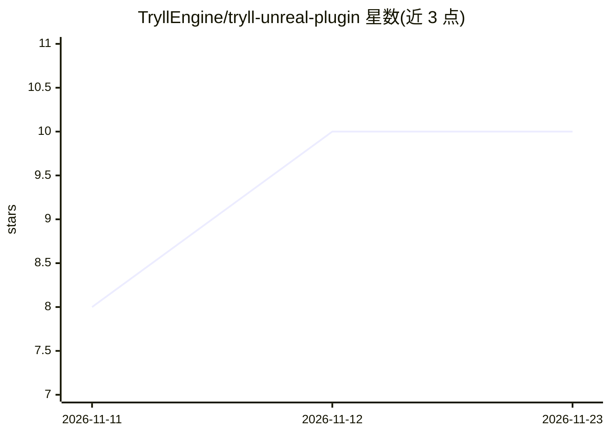

# TryllEngine/tryll-unreal-plugin

⭐ 10 · C++ · NOASSERTION · 推送 2026-11-10 · [GitHub](https://github.com/TryllEngine/tryll-unreal-plugin) · [官网](https://www.tryllengine.com) · 组织维护

**UE5 插件：在玩家本机运行 LLM 与语音模型驱动 AI NPC**

面向 Unreal Engine 5 的插件集，在玩家本地机器上运行语言、语音识别与语音合成模型，通过工作流驱动的 agent 接入游戏。含 TryllClient（agents、工作流、语音、编辑器窗口与 Tryll server）及可选的 MetaHuman 口型同步、MCP 编辑器插件。仅支持 Windows x64，提供 UE 5.7/5.8 预编译 zip（Blueprint 项目可用），或源码安装（需 C++ 项目，打包需 Visual Studio 2022）。仓库由发布流水线从主仓库生成，不接受直接改动。

## 筛选速览

| 维度 | 判定 | 备注 |
|---|---|---|
| AI 角色 | `ai-ecosystem` | LLM/agent 周边工具 |
| 许可风险 | `none` | NOASSERTION |
| 部署形态 | `desktop` | 安装包/桌面程序 |
| 模型依赖 | — | README 未给出锁定关系 |
| 硬件要求 | — | 无带数字的原话,不猜 |
| 安装摩擦 | `medium` | 含编译或系统依赖之一 |
| 成熟度 | — | 结构信号不足 |

## 能力要点

- 在玩家本机运行 LLM、语音转文本与文本转语音模型
- 提供 agents 与工作流机制接入游戏
- 可选 MetaHuman 口型同步插件与 MCP 编辑器插件
- UE 5.7/5.8 预编译 zip，支持纯 Blueprint 项目

## 适用场景

- 为游戏 NPC 添加本地运行的对话 AI
- 用本地语音识别与合成实现角色语音交互
- 为 MetaHuman 角色驱动口型动画

## 场景标签

`语音合成` `语音识别` · 领域:内容生成

## 证据(README 行号)

> L3: Tryll runs language, speech-to-text and text-to-speech models on the player's own machine, and
> L14: |`TryllClient/`|The Tryll client: agents, workflows, speech, the editor windows, and the Tryll server|—|
> L16: |`TryllMCP/`|Optional. Lets an AI coding agent create and check Tryll workflows through the editor's MCP server|`Tr

## 星数曲线

2026-11-11 8 → 2026-11-23 10（+2）

---
*卡片 v1 · prompt 1.4 · 生成 2026-11-20 · 置信度 high · 依据 README sha `945f69dc2b46` · [字段定义](../../DATASET.md)*
