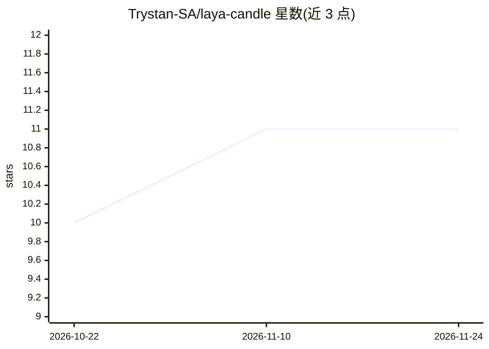

# Trystan-SA/laya-candle

⭐ 11 · Rust · Apache-2.0 · 推送 2026-10-02 · [GitHub](https://github.com/Trystan-SA/laya-candle) · [官网](https://crates.io/crates/laya-candle) · 组织维护

**Rust 库：本地对文本做分类打分与守门判定**

Laya 的纯 Rust 移植版，基于 candle 加载 Hugging Face Hub 上的检查点，在单次前向传播中回答 choice/score/noul 三类问题，返回带校准置信度的标签、分数或概率，输出不需解析也不会生成文本。面向工单分诊、邮件分拣、内容审核、LLM 前置提示守门等场景，可作为请求路径中间件嵌入 axum/actix/tonic 服务或编译为边缘单文件二进制。仅提供库与 CLI，无 Python 依赖；置信度仅在检查点能力范围内有效，温度被钳制的桶视为未校准。

## 筛选速览

| 维度 | 判定 | 备注 |
|---|---|---|
| AI 角色 | `ai-native` | 本体是模型或模型工具 |
| 许可风险 | `permissive` | Apache-2.0 |
| 部署形态 | `library` | 以包/库形式分发 |
| 模型依赖 | — | README 未给出锁定关系 |
| 硬件要求 | — | 无带数字的原话,不猜 |
| 安装摩擦 | `medium` | 含编译或系统依赖之一 |
| 成熟度 | — | 结构信号不足 |

## 能力要点

- choice/score/noul 三类原语，单次批量前向返回完整概率分布
- Router 在前向前以纯 Rust 检测脚本与语言，覆盖 100+ 语言
- 可按 mkl/accelerate/cuda/metal 特性启用对应硬件加速
- cargo install 提供 CLI，predict/route/presets 子命令可组合进 shell 管道

## 适用场景

- 在 Rust Web 服务内屏检提示词或路由工单，不经外部推理服务
- 在无网络的边缘设备上以单二进制运行文本分类
- 对 LLM 入口做 allow/review/block 提示守门
- 置信度低于阈值时升级人工处理

## 场景标签

 · 领域:机器学习/文本分类

## 证据(README 行号)

> L3: Use this crate to classify, score or check a piece of text from your Rust code: give it a message and a few question
> L7: Ask typed questions about any state (string, email, ticket, JSON) and get back a label, a score
> L8: or a probability, each with a calibrated confidence. Because nothing is generated, the answer never

## 星数曲线

2026-10-22 10 → 2026-11-24 11（+1）

---
*卡片 v1 · prompt 1.4 · 生成 2026-11-18 · 置信度 high · 依据 README sha `5036572064d3` · [字段定义](../../DATASET.md)*
