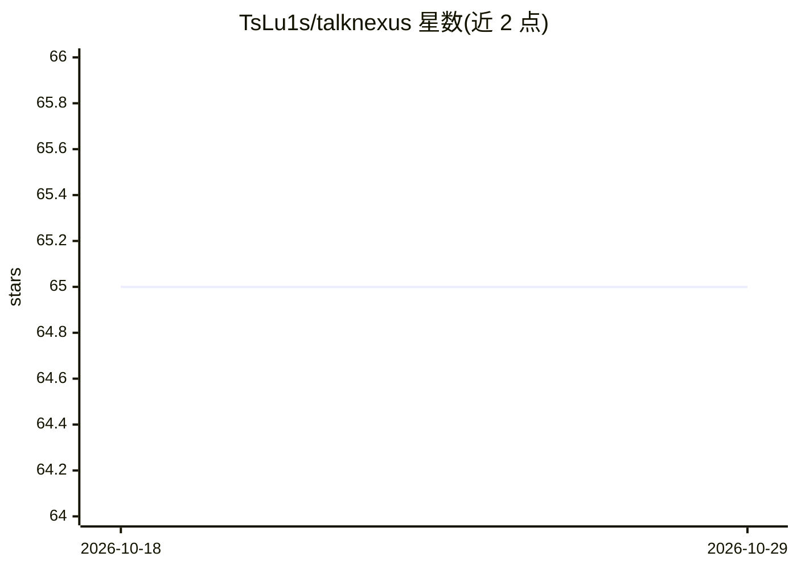

# TsLu1s/talknexus

⭐ 65 · Python · MIT · 推送 2026-01-17 · [GitHub](https://github.com/TsLu1s/talknexus) · 个人维护

**基于 Ollama 的多模型聊天与 RAG 文档问答 Streamlit 应用**

面向终端用户的 Streamlit 聊天应用：通过 Ollama API 接入 DeepSeek、Llama、Mistral 等 125+ 本地语言模型，提供模型下载与管理界面、带流式响应与自动命名的会话历史管理，以及基于 PDF 上传、多种嵌入模型与可调检索参数（chunk 大小、父文档）的 RAG 文档问答，支持实验配置保存以复现结果。需本地运行 Ollama，Python 3.11+，通过 Poetry 安装依赖后以 streamlit 命令启动；在线 Demo 版无法调用 Ollama API，完整功能需本地运行。

## 筛选速览

| 维度 | 判定 | 备注 |
|---|---|---|
| AI 角色 | `ai-native` | 本体是模型或模型工具 |
| 许可风险 | `permissive` | MIT |
| 部署形态 | `None` |  |
| 模型依赖 | local-ok | 支持本地模型 |
| 硬件要求 | — | 无带数字的原话,不猜 |
| 安装摩擦 | `low` | 无编译、无系统依赖或容器化 |
| 成熟度 | — | 结构信号不足 |

## 能力要点

- 通过 Ollama API 接入 125+ 语言模型并支持界面内下载与切换
- RAG 文档分析：PDF 上传、多种嵌入模型、可调 chunk 与检索设置
- 会话历史保存/加载/继续/删除，带自动命名
- 实验配置保存与复现

## 适用场景

- 在本地与多个 Ollama 模型对话并管理模型
- 上传 PDF 文档做基于内容的问答
- 保存和复现不同的文档分析检索配置

## 场景标签

`聊天机器人` `文档问答` · 领域:对话与助手

## 证据(README 行号)

> L3: A comprehensive and scalable Chatbot Application that integrates multiple language models through the Ollama API, fe
> L11: - **RAG-Powered Document Analysis**: Advanced document processing system supporting PDF analysis with multiple embe

## 星数曲线

2026-10-18 65 → 2026-10-29 65（+0）

---
*卡片 v1 · prompt 1.4 · 生成 2026-10-24 · 置信度 high · 依据 README sha `ae28132f853e` · [字段定义](../../DATASET.md)*
