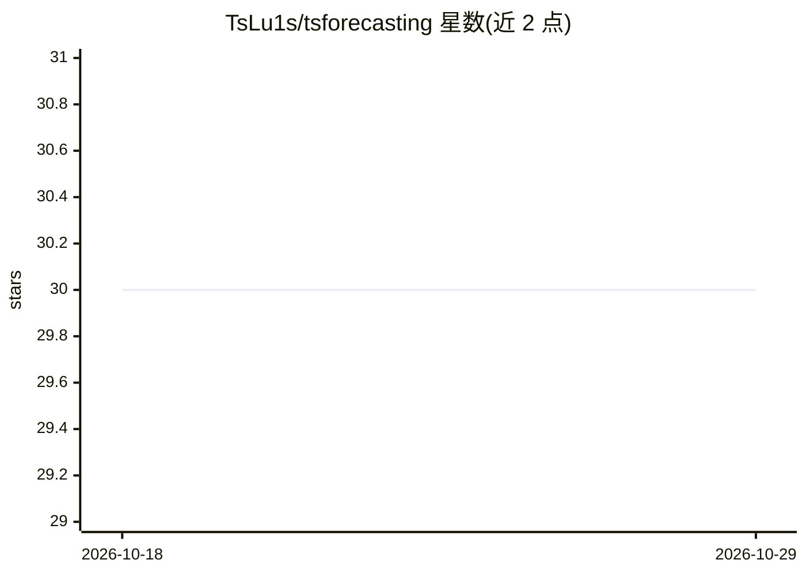

# TsLu1s/tsforecasting

⭐ 30 · Python · MIT · 推送 2026-02-10 · [GitHub](https://github.com/TsLu1s/tsforecasting) · 个人维护

**面向数据科学家的自动化时间序列预测框架**

Python 库形式的自动化时间序列预测流水线，整合 SKLearn、AutoGluon、CatBoost、XGBoost 等多种回归模型，按预处理、特征工程、超参优化、模型评估、预测五段组织。采用 Expanding Window 方式滚动评估并自动选择最优模型，支持 MAE/MAPE/MSE 指标选择。提供 80%/90%/95%/99% 四档覆盖率、ensemble/quantile/conformal/gaussian 四种方法的预测区间，另含 Builder 配置模式、时序变换与树模型特征选择辅助方法。适用于任意含 DateTime 与目标列的表格数据。经 pip 从 PyPI 安装。

## 筛选速览

| 维度 | 判定 | 备注 |
|---|---|---|
| AI 角色 | `ai-native` | 本体是模型或模型工具 |
| 许可风险 | `permissive` | MIT |
| 部署形态 | `library` | 以包/库形式分发 |
| 模型依赖 | — | README 未给出锁定关系 |
| 硬件要求 | — | 无带数字的原话,不猜 |
| 安装摩擦 | `low` | 无编译、无系统依赖或容器化 |
| 成熟度 | — | 结构信号不足 |

## 能力要点

- 整合 SKLearn/AutoGluon/CatBoost/XGBoost 等多模型的自动化预测流水线
- Expanding Window 滚动评估并自动选择最优模型
- 四档覆盖率、四种方法（ensemble/quantile/conformal/gaussian）的预测区间
- 附带 Builder 配置模式、make_timeseries 变换与树模型特征选择辅助方法

## 适用场景

- 在表格时间序列数据上自动训练并比较多种预测模型
- 生成带不确定性区间的未来预测
- 分析各模型在不同窗口与预测步长上的表现

## 场景标签

`数据分析` `MLOps` · 领域:效率与自动化

## 证据(README 行号)

> L12: The `TSForecasting` project offers a comprehensive and integrated pipeline designed to Automate Time Series Forecas
> L57: The pipeline follows a straightforward workflow: configure parameters, fit the model across expanding windows, eval

## 星数曲线

2026-10-18 30 → 2026-10-29 30（+0）

---
*卡片 v1 · prompt 1.4 · 生成 2026-10-26 · 置信度 high · 依据 README sha `d6b50bec5d53` · [字段定义](../../DATASET.md)*
