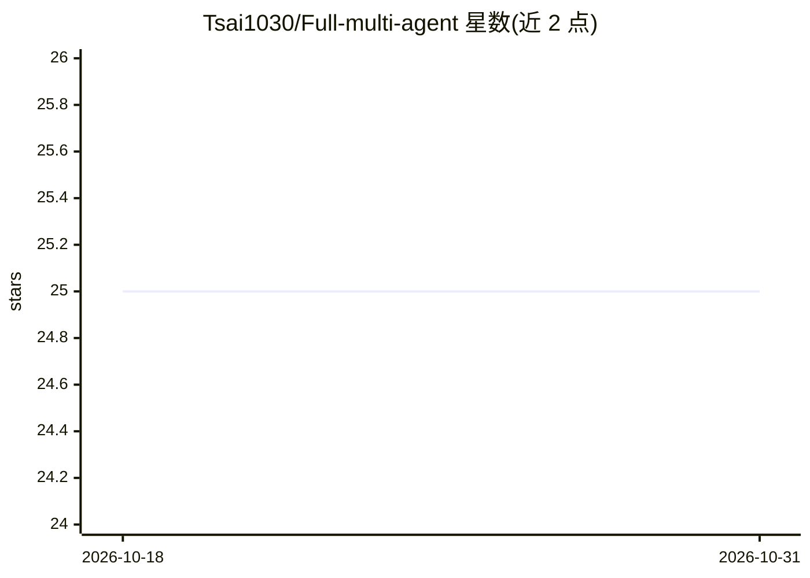

# Tsai1030/Full-multi-agent

⭐ 25 · Python · 推送 2026-06-10 · [GitHub](https://github.com/Tsai1030/Full-multi-agent) · 个人维护 · 中文 README

**紫微斗數 AI 算命 SaaS：真實排盤+LangGraph 多代理解盤**

面向終端用戶的紫微斗數命理 Web 應用：前端以 iztro 引擎依出生資料精確排盤，命盤 JSON 送至後端由 LangGraph multi-agent（researcher 檢索 ChromaDB RAG 知識庫 → 推理/領域/創意三 agent 並行 → coordinator 彙整）解讀，LLM 與嵌入均用 Google Gemini。含會員訂閱與星辰代幣制、Google 登入、JWT 認證、SSE 串流對談、合盤分析。技術棧 FastAPI + Next.js 14 + PostgreSQL，Docker 化並可部署至 Render，另提供線上 Demo。

## 筛选速览

| 维度 | 判定 | 备注 |
|---|---|---|
| AI 角色 | `ai-native` | 本体是模型或模型工具 |
| 许可风险 | `permissive` | — |
| 部署形态 | `self-host` | docker 或自建部署 |
| 模型依赖 | — | README 未给出锁定关系 |
| 硬件要求 | — | 无带数字的原话,不猜 |
| 安装摩擦 | `low` | 无编译、无系统依赖或容器化 |
| 成熟度 | — | 结构信号不足 |

## 能力要点

- iztro 前端精確排盤，LLM 僅負責解讀不排盤
- LangGraph 三 agent 並行 fan-out/fan-in + coordinator 彙整
- ChromaDB RAG 知識庫（Gemini Embedding，啟動自動索引）
- 會員訂閱三層方案與星辰代幣消耗制

## 适用场景

- 輸入出生資料生成紫微斗數命盤並取得 AI 解盤報告
- 事業/感情分析後在獨立聊天室即時追問
- 雙人生辰合盤配對分析
- 註冊後保存多張命盤並與大師 persona 串流對談

## 场景标签

`多智能体` `聊天机器人` · 领域:Agent 开发

## 证据(README 行号)

> L18: > 命盤由官方 **iztro 排盤引擎** 精準計算（不由 LLM 編造），交給 **LangGraph multi-agent** 結合 **RAG 知識庫** 深度解盤；
> L77: - **三位獨立 persona 的 Gemini agent 並行分析**同一命盤：推理分析師、領域專家、創意詮釋師。
> L104: - LLM（`gemini-3.5-flash`）與 Embedding（`gemini-embedding-2`）皆使用 **Google Gemini**，只需一把金鑰。

## 星数曲线

2026-10-18 25 → 2026-10-31 25（+0）

---
*卡片 v1 · prompt 1.4 · 生成 2026-10-27 · 置信度 high · 依据 README sha `6cfdfaf190f7` · [字段定义](../../DATASET.md)*
