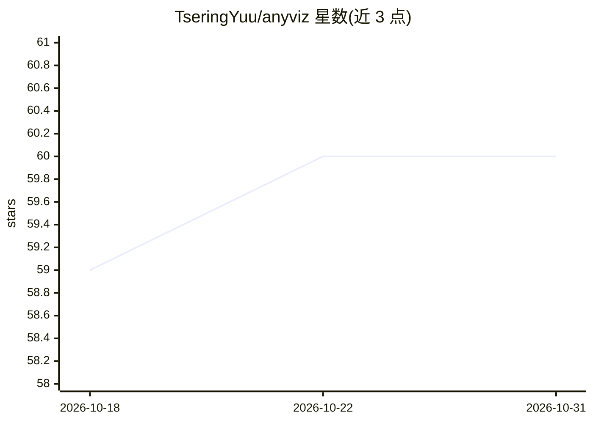

# TseringYuu/anyviz

⭐ 60 · Python · MIT · 推送 2026-08-06 · [GitHub](https://github.com/TseringYuu/anyviz) · [官网](https://anyviz.aiware.store) · 个人维护 · 中文 README

**给 AI 编程工具的数据可视化规范与工作流库（34 种模板）**

以 SKILL.md 为入口的 AI 工作流库与独立美学库：为 AI 助手提供图表选择、色彩/字号分级、多图一致性与无障碍规则，按分析→美学→适配→一致性→无障碍五阶段流水线执行。规范以纯 JSON 定义，可被脚本直接引用；自动检测技术栈，在 Web（D3/ECharts/Mapbox/Three.js）、Python（Plotly/Matplotlib）、R（ggplot2）产出代码。一键安装脚本将 Skill 部署到 Codex、Cursor、Claude Code 等多种 Agent 目录，也可 npm 安装或 git clone 使用。

## 筛选速览

| 维度 | 判定 | 备注 |
|---|---|---|
| AI 角色 | `ai-ecosystem` | LLM/agent 周边工具 |
| 许可风险 | `permissive` | MIT |
| 部署形态 | `library` | 以包/库形式分发 |
| 模型依赖 | — | README 未给出锁定关系 |
| 硬件要求 | — | 无带数字的原话,不猜 |
| 安装摩擦 | `low` | 无编译、无系统依赖或容器化 |
| 成熟度 | — | 结构信号不足 |

## 能力要点

- 34 种模板（20 图表+3 地图+8 图+3 三维），统一五段式规范结构
- 五阶段工作流：分析→美学→适配→一致性→无障碍
- 技术栈自适应：D3/ECharts/Mapbox/Three.js、Plotly/Matplotlib、ggplot2
- 自然语言指令映射到美学参数（深色模式、学术风格等）

## 适用场景

- 让 AI 编程助手按专业规范生成报告图表或数据大屏
- 项目内引用统一的美学规范保持多图视觉一致
- 生成色盲友好的出版级学术图表

## 场景标签

`代码生成` · 领域:编码与开发

## 证据(README 行号)

> L14: > **anyviz** 是一个面向 AI 时代的数据可视化规范与工作流库。
> L27: 把 anyviz 作为 AI 助手的可视化工作流上下文使用。AI 需要优先读取 `SKILL.md`，
> L33: curl -fsSL https://raw.githubusercontent.com/TseringYuu/anyviz/main/install.sh | sh

## 星数曲线

2026-10-18 59 → 2026-10-31 60（+1）

---
*卡片 v1 · prompt 1.4 · 生成 2026-10-24 · 置信度 high · 依据 README sha `22a041d2352d` · [字段定义](../../DATASET.md)*
