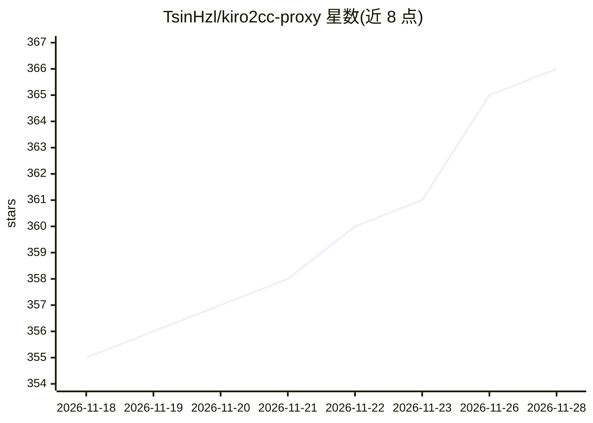

# TsinHzl/kiro2cc-proxy

⭐ 366 · Rust · MIT · 推送 2026-11-26 · [GitHub](https://github.com/TsinHzl/kiro2cc-proxy) · 个人维护 · 中文 README

**把 Kiro 账号模型代理给 Claude Code/Codex 的转换服务**

以 Rust 编写的代理服务，将 Anthropic Claude API 请求转换为 Kiro API 请求，使 Claude Code 与 Codex CLI 能调用 Kiro 账号上的模型；同时提供 OpenAI 兼容端点（/v1/chat/completions、/v1/responses）。支持 SSE 流式输出、前缀缓存、extended thinking、function calling 与 WebSearch 工具转换，内置 OAuth Token 自动刷新、多账号故障转移、负载均衡与重试机制。部署方式包括预编译包、源码构建、Docker Compose 镜像与 systemd。需持有 Kiro 账号并导出 refreshToken。

## 筛选速览

| 维度 | 判定 | 备注 |
|---|---|---|
| AI 角色 | `ai-ecosystem` | LLM/agent 周边工具 |
| 许可风险 | `permissive` | MIT |
| 部署形态 | `desktop` | 安装包/桌面程序 |
| 模型依赖 | locked-api |  |
| 硬件要求 | — | 无带数字的原话,不猜 |
| 安装摩擦 | `low` | 无编译、无系统依赖或容器化 |
| 成熟度 | — | 结构信号不足 |

## 能力要点

- Anthropic API 与 OpenAI 兼容双端点，接入 Claude Code/Codex CLI
- 多账号优先级/均衡负载、Token 自动刷新与分级重试
- SSE 流式输出、前缀缓存、extended thinking、工具调用转换
- 提供 Web Admin 管理面板与账号级 HTTP/SOCKS5 代理配置

## 适用场景

- 让 Claude Code 通过 Kiro 账号调用模型
- 用 OpenAI SDK 客户端接入 Kiro 上的模型
- 多账号场景下做故障转移与负载均衡
- 服务器端以 Docker/systemd 常驻运行代理服务

## 场景标签

`模型网关` · 领域:Agent 开发

## 证据(README 行号)

> L3: **将 Anthropic Claude API 请求转换为 Kiro API 请求的 Rust 代理服务**
> L44: kiro2cc-proxy 是一个代理服务。它把标准的 Anthropic Claude API 请求转发给 Kiro（AWS 的 AI 编程工具），让你可以用 Claude Code使用Kiro账号的模型。
> L28: |**🧬 OpenAI 兼容 / Codex CLI**|提供 `/v1/chat/completions` 与 `/v1/responses` 端点，可直接接入 Codex CLI 及任意 OpenAI SDK 客户端|

## 星数曲线

2026-11-18 355 → 2026-11-28 366（+11）

---
*卡片 v1 · prompt 1.4 · 生成 2026-11-27 · 置信度 high · 依据 README sha `129555692381` · [字段定义](../../DATASET.md)*
