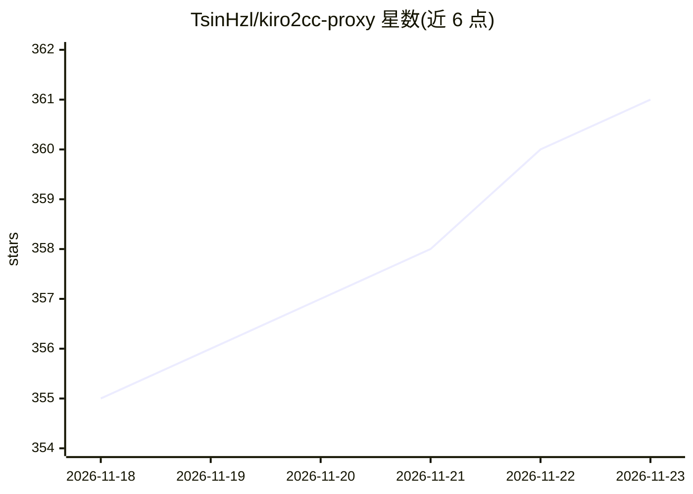

# TsinHzl/kiro2cc-proxy

⭐ 361 · Rust · MIT · 推送 2026-11-22 · [GitHub](https://github.com/TsinHzl/kiro2cc-proxy) · 个人维护 · 中文 README

**把 Kiro 账号模型代理给 Claude Code/Codex 的 Rust 代理服务**

Rust 编写的本地/服务器代理服务：将标准 Anthropic Claude API 及 OpenAI 兼容请求转发给 Kiro（AWS AI 编程工具），使 Claude Code、Codex CLI 及任意 OpenAI SDK 客户端可使用 Kiro 账号下的模型。支持 SSE 流式输出、thinking 模式、工具调用、WebSearch 转换、OAuth Token 自动刷新、多账号故障转移与负载均衡、账号级 HTTP/SOCKS5 代理及 4 上游端点轮询限流处理，附带 Web 管理面板。部署需源码构建（Rust+Node.js）或使用 Docker 预构建镜像；国内网络须配置本地代理。README 声明仅供研究使用。

## 筛选速览

| 维度 | 判定 | 备注 |
|---|---|---|
| AI 角色 | `ai-ecosystem` | LLM/agent 周边工具 |
| 许可风险 | `permissive` | MIT |
| 部署形态 | `desktop` | 安装包/桌面程序 |
| 模型依赖 | locked-api |  |
| 硬件要求 | — | 无带数字的原话,不猜 |
| 安装摩擦 | `low` | 无编译、无系统依赖或容器化 |
| 成熟度 | — | 结构信号不足 |

## 能力要点

- Anthropic API 与 OpenAI 兼容端点（/v1/chat/completions、/v1/responses）
- 多账号优先级/均衡负载、单请求最多 9 次重试自动故障转移
- 4 个 Kiro 上游端点独立限流桶，429 时按桶封禁 30s
- Web 管理面板支持 KAM 账号导入与额度验活

## 适用场景

- 在 Claude Code 或 Codex CLI 中使用 Kiro 账号的模型
- 多账号聚合管理与故障转移部署
- 通过 Docker 在服务器上自建代理服务

## 场景标签

`模型网关` · 领域:Agent 开发

## 证据(README 行号)

> L3: **将 Anthropic Claude API 请求转换为 Kiro API 请求的 Rust 代理服务**
> L44: kiro2cc-proxy 是一个代理服务。它把标准的 Anthropic Claude API 请求转发给 Kiro（AWS 的 AI 编程工具），让你可以用 Claude Code使用Kiro账号的模型。
> L28: |**🧬 OpenAI 兼容 / Codex CLI**|提供 `/v1/chat/completions` 与 `/v1/responses` 端点，可直接接入 Codex CLI 及任意 OpenAI SDK 客户端|

## 星数曲线

2026-11-18 355 → 2026-11-23 361（+6）

---
*卡片 v1 · prompt 1.4 · 生成 2026-11-18 · 置信度 high · 依据 README sha `739d43459132` · [字段定义](../../DATASET.md)*
