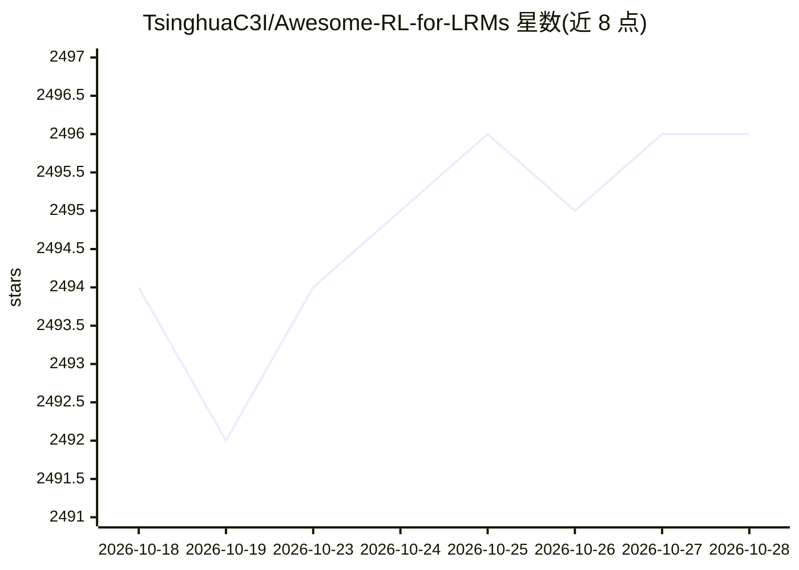

# TsinghuaC3I/Awesome-RL-for-LRMs

⭐ 2,497 · TeX · MIT · 推送 2026-09-14 · [GitHub](https://github.com/TsinghuaC3I/Awesome-RL-for-LRMs) · [官网](https://arxiv.org/abs/2509.08827) · 组织维护 · 中文 README

**大推理模型强化学习综述论文清单（科研向策展）**

清华 C3I 团队维护的《A Survey of Reinforcement Learning for Large Reasoning Models》配套论文清单：按前沿模型、生成式奖励、稠密奖励等类别以表格形式收录论文及代码链接，覆盖奖励设计、策略优化、训练资源、应用与未来方向五个部分；新闻区还发布团队相关项目（TTRL、MARTI、SSRL 等）及 OpenRSI/OpenMLE 数据集发布信息。面向从事 LLM/RLM 强化学习研究的读者。

## 筛选速览

| 维度 | 判定 | 备注 |
|---|---|---|
| AI 角色 | `ai-knowledge` | 知识聚合/清单类 |
| 许可风险 | `permissive` | MIT |
| 部署形态 | `None` |  |
| 模型依赖 | — | README 未给出锁定关系 |
| 硬件要求 | — | 无带数字的原话,不猜 |
| 安装摩擦 | `low` | 无编译、无系统依赖或容器化 |
| 成熟度 | — | 结构信号不足 |

## 能力要点

- 综述配套论文清单，按奖励设计等类别表格化组织
- 覆盖 DeepSeek-R1、GLM-4.5、Kimi K2 等前沿模型条目
- 含生成式奖励与稠密奖励等细分方向的大量论文及 GitHub 链接

## 适用场景

- 查找 LRM 强化学习各方向的代表性论文与开源代码
- 跟踪研究团队的相关项目与数据集发布
- 作为入门该领域的分类阅读路线

## 场景标签

`精选清单` `科研工具` `强化学习` · 领域:学习与行业

## 证据(README 行号)

> L1: ## A Survey of Reinforcement Learning for Large Reasoning Models
> L45: 1. <u>Foundational Components:</u> Reward design, policy optimization, and sampling strategies
> L55: |Date|Name|Title|Paper|Github|

## 星数曲线

2026-10-18 2,494 → 2026-10-28 2,496（+2）

---
*卡片 v1 · prompt 1.4 · 生成 2026-10-21 · 置信度 high · 依据 README sha `525a5fdf8ed2` · [字段定义](../../DATASET.md)*
