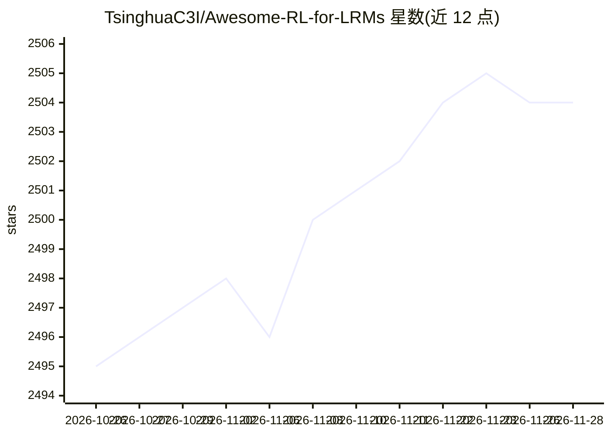

# TsinghuaC3I/Awesome-RL-for-LRMs

⭐ 2,504 · TeX · MIT · 推送 2026-11-18 · [GitHub](https://github.com/TsinghuaC3I/Awesome-RL-for-LRMs) · [官网](https://arxiv.org/abs/2509.08827) · 组织维护 · 中文 README

**面向研究者的强化学习训练大推理模型论文集**

清华大学 C3I 团队维护的论文清单，配套 arXiv 综述《A Survey of Reinforcement Learning for Large Reasoning Models》。内容按五大板块组织：基础组件（奖励设计、策略优化、采样策略）、基础问题、训练资源、应用与未来方向。README 以表格形式按日期列出前沿模型与各奖励设计方向的论文、博客与代码链接，并附 BibTeX 引用格式，通过 issue 接收补充条目。

## 筛选速览

| 维度 | 判定 | 备注 |
|---|---|---|
| AI 角色 | `ai-knowledge` | 知识聚合/清单类 |
| 许可风险 | `permissive` | MIT |
| 部署形态 | `None` |  |
| 模型依赖 | — | README 未给出锁定关系 |
| 硬件要求 | — | 无带数字的原话,不猜 |
| 安装摩擦 | `low` | 无编译、无系统依赖或容器化 |
| 成熟度 | — | 结构信号不足 |

## 能力要点

- 配套 arXiv 综述（arXiv:2509.08827）的分类论文清单
- 按奖励设计、密集奖励等子类组织的论文表格
- 覆盖 DeepSeek-R1、Qwen3、Kimi K2 等前沿模型条目
- 欢迎通过 issue 提交未收录的相关工作

## 适用场景

- 调研强化学习训练推理模型的研究进展
- 查找奖励模型设计相关论文与开源实现
- 撰写综述或论文时获取分类文献线索

## 场景标签

`精选清单` `强化学习` · 领域:学习与行业

## 证据(README 行号)

> L39: Our survey provides a comprehensive examination of **Reinforcement Learning for Large Reasoning Models**.
> L51: ## 📄 Paper List
> L55: |Date|Name|Title|Paper|Github|

## 星数曲线

2026-10-26 2,495 → 2026-11-28 2,504（+9）

---
*卡片 v1 · prompt 1.4 · 生成 2026-11-23 · 置信度 high · 依据 README sha `94f047309c07` · [字段定义](../../DATASET.md)*
