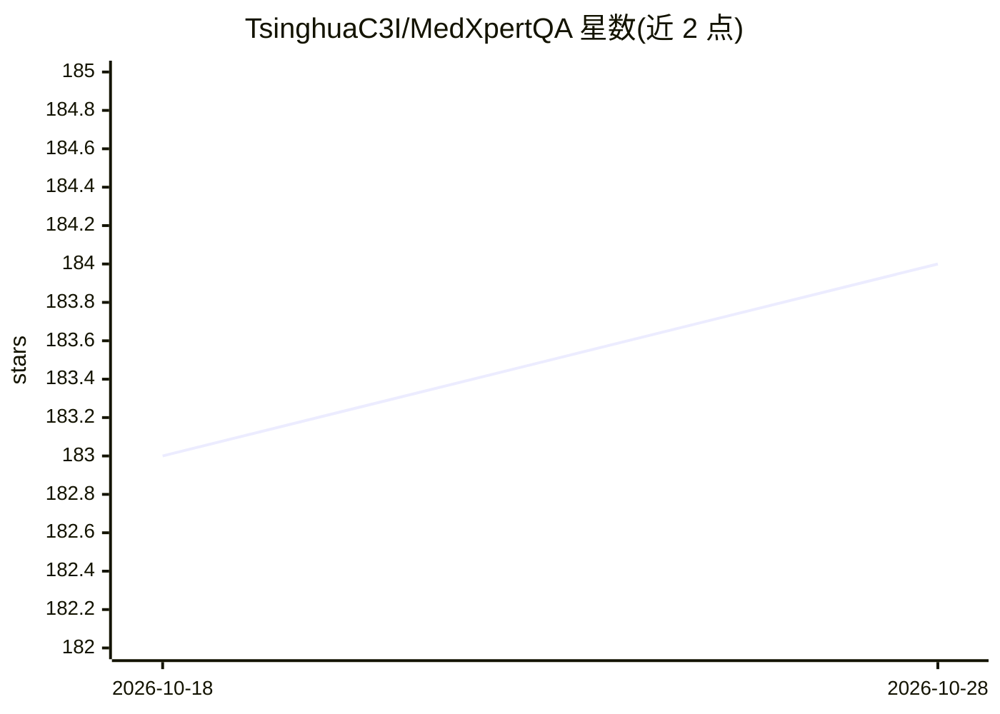

# TsinghuaC3I/MedXpertQA

⭐ 184 · Python · MIT · 推送 2026-09-07 · [GitHub](https://github.com/TsinghuaC3I/MedXpertQA) · [官网](https://medxpertqa.github.io) · 组织维护 · 中文 README

**专家级医学推理与理解能力的评测基准数据集**

MedXpertQA 是 ICML 2025 论文发布的医学评测基准，含 4,460 道题目，覆盖 17 个专科和 11 个人体系统，分文本子集与多模态子集（MM）。题目来自美国医学专科委员会执照考试并经数据合成与多轮专家审核以缓解数据泄漏，另提供面向推理评估的子集。已被 Google DeepMind、Meta、字节 Seed、阿里 Qwen 等官方评测采用，并集成进 OpenCompass 与 EvalScope。仓库提供推理脚本与准确率评估 notebook，MIT 许可。

## 筛选速览

| 维度 | 判定 | 备注 |
|---|---|---|
| AI 角色 | `ai-knowledge` | 知识聚合/清单类 |
| 许可风险 | `permissive` | MIT |
| 部署形态 | `library` | 以包/库形式分发 |
| 模型依赖 | — | README 未给出锁定关系 |
| 硬件要求 | — | 无带数字的原话,不猜 |
| 安装摩擦 | `low` | 无编译、无系统依赖或容器化 |
| 成熟度 | — | 结构信号不足 |

## 能力要点

- 4,460 道题、17 个专科、11 个人体系统的双子集（Text/MM）基准
- 题目来自美国医学专科委员会执照考试，经专家多轮审核与数据合成
- 提供面向 o1 类模型的推理导向评测子集
- 附带推理脚本与 EvalScope/OpenCompass 集成的评测流程

## 适用场景

- 评估 LLM/LMM 的专家级医学知识与推理能力
- 比较多模态医学模型在临床信息理解上的表现
- 作为医学方向模型发布与技术报告的官方评测项

## 场景标签

`模型评测` · 领域:评测与运维

## 证据(README 行号)

> L28: **MedXpertQA** includes 4,460 questions spanning 17 specialties and 11 body systems. It includes two subsets, **Med
> L40: - **Highly Challenging:** MedXpertQA introduces high-difficulty medical exam questions and applies rigorous filteri

## 星数曲线

2026-10-18 183 → 2026-10-28 184（+1）

---
*卡片 v1 · prompt 1.4 · 生成 2026-10-22 · 置信度 mid · 依据 README sha `d956eb33a0ad` · [字段定义](../../DATASET.md)*
