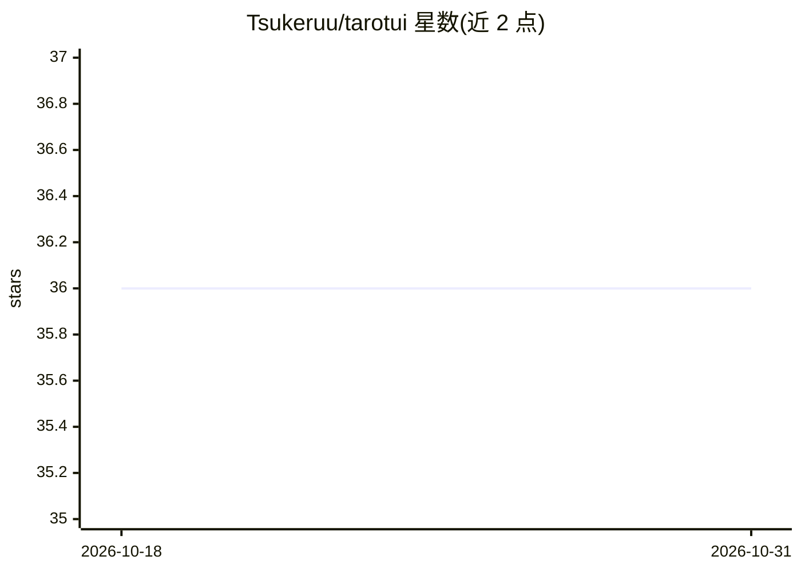

# Tsukeruu/tarotui

⭐ 36 · Python · MIT · 推送 2026-05-22 · [GitHub](https://github.com/Tsukeruu/tarotui) · 个人维护

**终端塔罗牌占卜体验：本地 ollama 模型解读抽牌结果**

用 Python 编写的终端塔罗牌占卜程序：后端完成洗牌抽牌，用户提问由本地 ollama 模型分析并生成解读文本，模型通过 Modelfile 构建带占卜人设的自定义模型。默认 master 分支使用 llama3.2（2-3GB），切换分支可用 deepseek-r1 或 qwen3.5:4b。提供 install.sh 安装脚本或手动 pip 安装依赖，需自行安装 python 与 ollama，可写 shell 脚本加入 PATH。README 自述网络请求较慢、未覆盖各发行版包管理器安装。

## 筛选速览

| 维度 | 判定 | 备注 |
|---|---|---|
| AI 角色 | `ai-native` | 本体是模型或模型工具 |
| 许可风险 | `permissive` | MIT |
| 部署形态 | `library` | 以包/库形式分发 |
| 模型依赖 | local-ok | 支持本地模型 |
| 硬件要求 | — | 无带数字的原话,不猜 |
| 安装摩擦 | `low` | 无编译、无系统依赖或容器化 |
| 成熟度 | `idea` | |

## 能力要点

- 后端洗牌抽牌 + ollama 模型分析提问
- 通过 Modelfile 构建带占卜人设的自定义模型
- 三个分支对应三种本地模型（llama3.2/deepseek-r1/qwen3.5:4b）
- 提供 install.sh 一键安装或手动 pip 安装两种方式

## 适用场景

- 在终端里进行塔罗牌占卜并获得 AI 解读
- 本地模型爱好者体验带人设的 ollama Modelfile 应用

## 场景标签

 · 领域:娱乐/占卜

## 证据(README 行号)

> L29: - **TAROTUI** is a tarot reading experience in the terminal built with python 🐍, questions are analyzed through oll
> L73: ollama create tarotui -f src/utils/Ollama_custom/Modelfile

## 星数曲线

2026-10-18 36 → 2026-10-31 36（+0）

---
*卡片 v1 · prompt 1.4 · 生成 2026-10-25 · 置信度 mid · 依据 README sha `e295922c4c35` · [字段定义](../../DATASET.md)*
