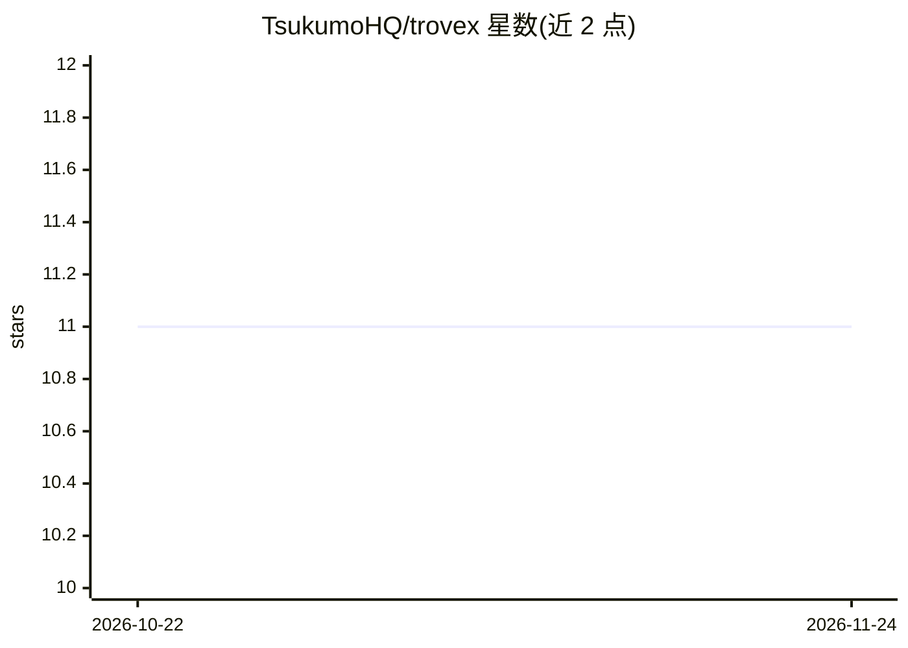

# TsukumoHQ/trovex

⭐ 11 · Python · AGPL-3.0 · 推送 2026-10-14 · [GitHub](https://github.com/TsukumoHQ/trovex) · [官网](https://trovex.dev) · 组织维护

**为编码 agent 按问题返回唯一权威文档的 MCP 文档路由器**

trovex 以 MCP 服务器形式运行：索引仓库中的 markdown，对每个查询返回一条带新鲜度标记（canonical/stale/duplicate）的 path:line 指针，并只提供回答问题所需的小节而非整文件。向量存于 SQLite，嵌入经 ONNX 本地生成，无云端调用与 API key；agent 可通过固定写入工具共享学到的记录。安装走 PyPI（uv tool install），配置 Claude Code/Cursor 等 MCP 客户端使用。项目处于公开 beta，AGPL-3.0-or-later 许可，另有团队级商业咨询。

## 筛选速览

| 维度 | 判定 | 备注 |
|---|---|---|
| AI 角色 | `ai-ecosystem` | LLM/agent 周边工具 |
| 许可风险 | `viral` | AGPL-3.0 |
| 部署形态 | `library` | 以包/库形式分发 |
| 模型依赖 | local-ok | 支持本地模型 |
| 硬件要求 | — | 无带数字的原话,不猜 |
| 安装摩擦 | `low` | 无编译、无系统依赖或容器化 |
| 成熟度 | `idea` | |

## 能力要点

- 每个查询路由到唯一当前文档并只服务相关小节，附新鲜度标记
- 六类 MCP 工具：三个只读（route/read/search）加三个仅写自身存储的工具
- 本地优先：SQLite 向量 + ONNX bge-small 嵌入，无 API key
- 提供 bench/eval-harness 用于在自有仓库测量 token 节省

## 适用场景

- 让 Claude Code、Cursor 等编码 agent 按问题取用权威文档而非重读仓库
- 团队多名 agent/成员共享同一份文档事实源并回写经验记录
- 测量文档检索在自有仓库上的 token 消耗差异

## 场景标签

`RAG` `语义搜索` · 领域:知识与检索

## 证据(README 行号)

> L13: trovex indexes your repo's markdown and exposes one MCP tool. Your agent asks a question;
> L58: trovex is an MCP server. Point your client at `http://localhost:8765/mcp` after `trovex serve`.

## 星数曲线

2026-10-22 11 → 2026-11-24 11（+0）

---
*卡片 v1 · prompt 1.4 · 生成 2026-11-18 · 置信度 high · 依据 README sha `b15ff1211ec5` · [字段定义](../../DATASET.md)*
