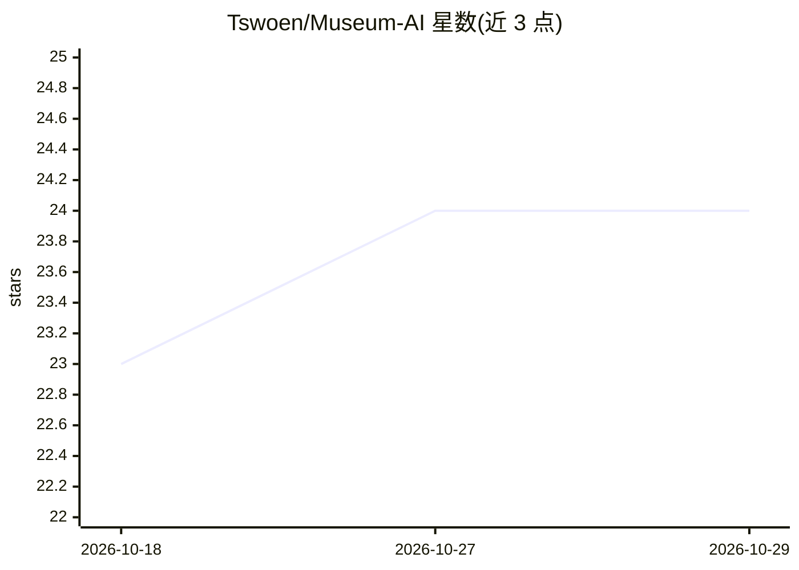

# Tswoen/Museum-AI

⭐ 24 · Vue · 推送 2026-05-23 · [GitHub](https://github.com/Tswoen/Museum-AI) · 个人维护 · 中文 README

**面向博物馆文物领域的多模态知识库与智能问答系统**

基于 LangGraph/LangChain 构建的博物馆知识管理与对话系统，前后端分离（FastAPI + Vue 3）。支持 ChromaDB 向量库与基于 LightRAG/Neo4j 的知识图谱双引擎，可索引 PDF、图片、文本、CSV、JSON 等格式，图片嵌入使用 CN-CLIP 模型；提供 ChatbotAgent 智能体、动态工具调用与 MCP 工具扩展，并预定义了文物领域实体/关系类型。需配置 LLM API 密钥（如 OpenAI、SiliconFlow）运行，源码部署依赖 Python 3.10+、Node.js 18+、Poetry、pnpm。

## 筛选速览

| 维度 | 判定 | 备注 |
|---|---|---|
| AI 角色 | `ai-native` | 本体是模型或模型工具 |
| 许可风险 | `none` | — |
| 部署形态 | `library` | 以包/库形式分发 |
| 模型依赖 | — | README 未给出锁定关系 |
| 硬件要求 | — | 无带数字的原话,不猜 |
| 安装摩擦 | `low` | 无编译、无系统依赖或容器化 |
| 成熟度 | — | 结构信号不足 |

## 能力要点

- ChromaDB 向量库与 LightRAG/Neo4j 知识图谱双引擎，五种检索模式
- CN-CLIP 图片嵌入与多格式文件索引（PDF/图片/文本/CSV/JSON）
- 基于 LangGraph 的智能体系统，支持动态工具调用与 MCP 扩展
- JWT 认证、登录频率限制与 API 权限管理

## 适用场景

- 博物馆工作者构建并检索文物领域知识库
- 文物研究中进行知识图谱关联与智能问答
- 展览策划与导览场景的知识查询支撑

## 场景标签

`知识库管理` `知识图谱` `多模态` `文档问答` · 领域:知识与检索

## 证据(README 行号)

> L7: 博物馆智能知识库与对话系统，基于 LangGraph 和 LangChain 构建的智能助手，专注于博物馆文物领域的知识管理和智能问答。
> L11: Museum-AI 是一个功能完整的博物馆知识管理系统，集成了向量检索和知识图谱技术，支持多种文件格式的知识库构建，并提供基于智能体的对话交互能力。
> L30:  - ChatbotAgent：基础对话机器人

## 星数曲线

2026-10-18 23 → 2026-10-29 24（+1）

---
*卡片 v1 · prompt 1.4 · 生成 2026-10-27 · 置信度 high · 依据 README sha `53ae8c20363d` · [字段定义](../../DATASET.md)*
