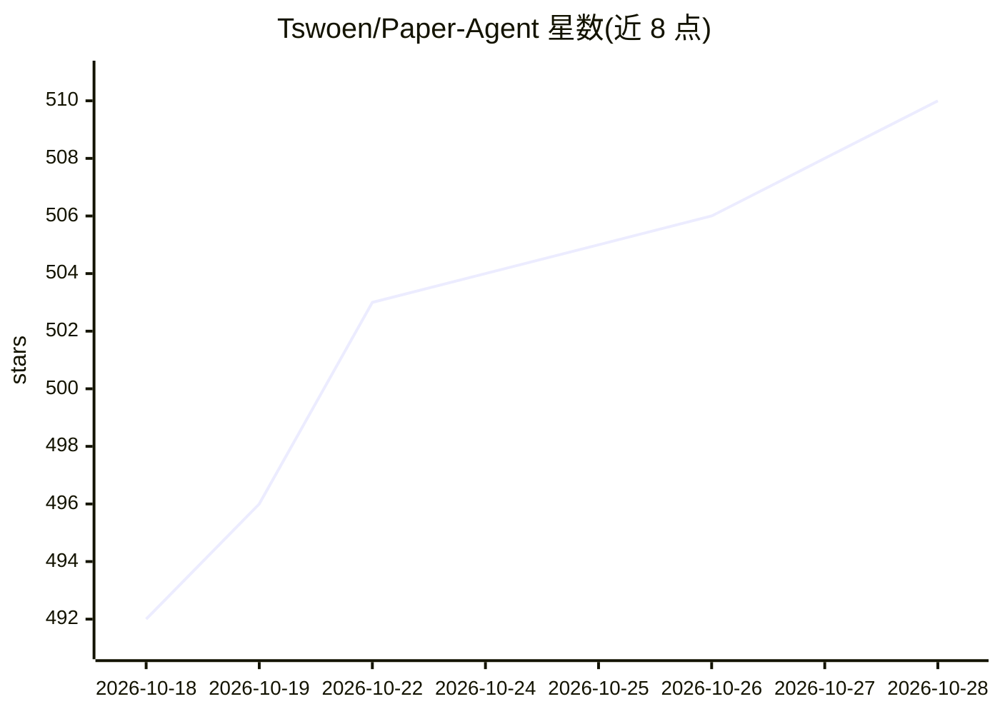

# Tswoen/Paper-Agent

⭐ 511 · Python · 推送 2026-09-18 · [GitHub](https://github.com/Tswoen/Paper-Agent) · 个人维护 · 中文 README

**多智能体驱动的论文检索与综述写作工作台**

面向科研人员与学生的本地部署 Web 应用：输入研究主题后，SearchAgent 生成检索计划，从 arXiv、OpenAlex、Semantic Scholar 三源检索并去重评分；随后渐进式阅读（摘要判断、下载、PDF 转 Markdown、分块入库 ChromaDB）、分层分析（子主题+全局综合）、大纲生成与逐节证据约束写作。前端 Vue 3 工作台经 SSE 实时推送进度，SQLite 持久化会话。支持 OpenAI/Anthropic 及兼容协议的模型配置，各 Agent 可指定不同模型档位。安装依赖 uv 与 npm，需自行配置模型密钥。

## 筛选速览

| 维度 | 判定 | 备注 |
|---|---|---|
| AI 角色 | `ai-native` | 本体是模型或模型工具 |
| 许可风险 | `none` | — |
| 部署形态 | `None` |  |
| 模型依赖 | — | README 未给出锁定关系 |
| 硬件要求 | — | 无带数字的原话,不猜 |
| 安装摩擦 | `low` | 无编译、无系统依赖或容器化 |
| 成熟度 | — | 结构信号不足 |

## 能力要点

- arXiv/OpenAlex/Semantic Scholar 三源统一检索与去重评分
- 摘要到全文的渐进式阅读，写入本地 ChromaDB 向量库
- 五个 Agent（Search/Read/Analyse/Outline/Writing）分工的 LangGraph 工作流
- SSE 实时进度推送与浏览器可视化模型配置（OpenAI/Anthropic 及兼容协议）

## 适用场景

- 输入研究主题自动生成领域综述并全程追踪进度
- 为陌生研究方向批量检索、筛选并建立本地可检索资料库
- 撰写综述时按证据映射逐节生成并审查修改

## 场景标签

`科研工具` `RAG` `多智能体` · 领域:Agent 开发

## 证据(README 行号)

> L3: **输入一个研究主题 → 收获一份可全程追踪的领域综述**
> L44: > **Paper-Agent 不只是论文摘要工具，而是一个完整的 AI 研究助理——它找得到论文、读得懂全文、理得清脉络、写得出综述。**
> L74: |LLM 适配|OpenAI 兼容协议、Anthropic Messages 协议|

## 星数曲线

2026-10-18 492 → 2026-10-28 510（+18）

---
*卡片 v1 · prompt 1.4 · 生成 2026-10-21 · 置信度 high · 依据 README sha `6af352e501cc` · [字段定义](../../DATASET.md)*
