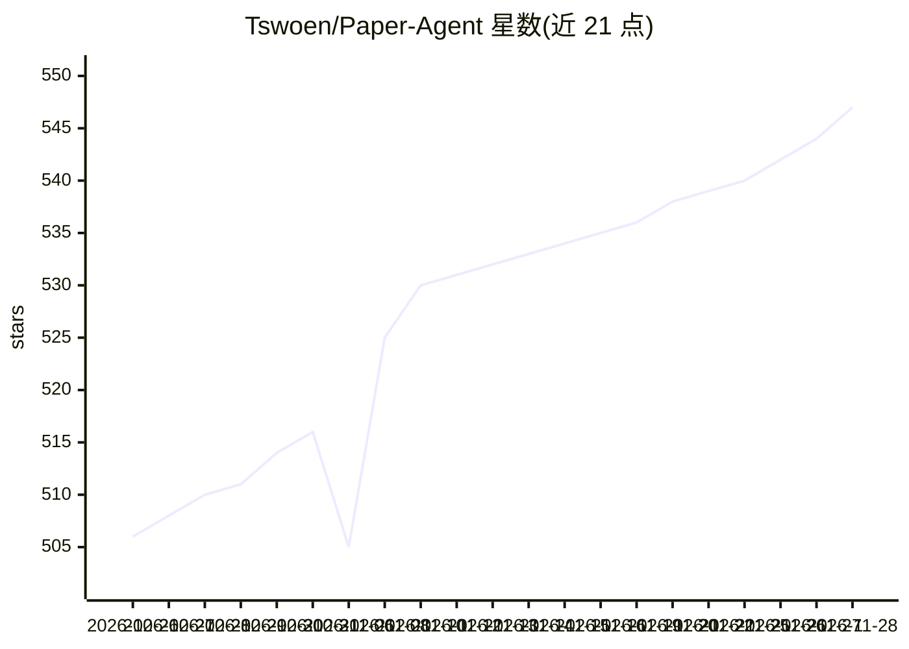

# Tswoen/Paper-Agent

⭐ 547 · Python · 推送 2026-11-26 · [GitHub](https://github.com/Tswoen/Paper-Agent) · 个人维护 · 中文 README

**面向科研人员的多智能体论文检索与综述写作工作台**

基于 LangGraph 多智能体协作的应用：从 arXiv、OpenAlex、Semantic Scholar 三源检索论文，经摘要相关性判断、全文下载解析、ChromaDB 向量入库、分层子主题分析，生成结构化大纲后逐节按证据写作综述。FastAPI 后端 + Vue 3 前端，SSE 实时推送进度，SQLite 持久化会话，支持异常重启恢复。模型按 OpenAI 兼容 / Anthropic 协议配置，各 Agent 可独立指定模型档位并展示 token 用量；需自备 API key，default_agent 配置缺失时无法工作。

## 筛选速览

| 维度 | 判定 | 备注 |
|---|---|---|
| AI 角色 | `ai-native` | 本体是模型或模型工具 |
| 许可风险 | `none` | — |
| 部署形态 | `None` |  |
| 模型依赖 | — | README 未给出锁定关系 |
| 硬件要求 | — | 无带数字的原话,不猜 |
| 安装摩擦 | `low` | 无编译、无系统依赖或容器化 |
| 成熟度 | — | 结构信号不足 |

## 能力要点

- 检索→阅读→分析→大纲→写作全流程多智能体流水线，进度实时可观察
- arXiv / OpenAlex / Semantic Scholar 三源统一检索与去重评分
- 证据约束写作：大纲生成证据映射，证据不足时检索补充并限次修改
- 浏览器可视化配置 Provider、密钥与三个 Agent 模型档位

## 适用场景

- 输入研究主题自动生成领域综述初稿
- 陌生方向快速摸底，替代手动多平台检索
- 长周期调研任务中途保存与恢复

## 场景标签

`多智能体` `RAG` `科研工具` · 领域:Agent 开发

## 证据(README 行号)

> L3: **输入一个研究主题 → 收获一份可全程追踪的领域综述**
> L44: > **Paper-Agent 不只是论文摘要工具，而是一个完整的 AI 研究助理——它找得到论文、读得懂全文、理得清脉络、写得出综述。**
> L53: |✍️|**证据约束下的综述写作**|`WritingOutlineAgent` 生成大纲与证据映射，`WritingAgent` 逐节写作、证据不足时检索补充、完成后审查并限次修改|

## 星数曲线

2026-10-26 506 → 2026-11-28 547（+41）

---
*卡片 v1 · prompt 1.4 · 生成 2026-11-27 · 置信度 high · 依据 README sha `03438420d2bc` · [字段定义](../../DATASET.md)*
