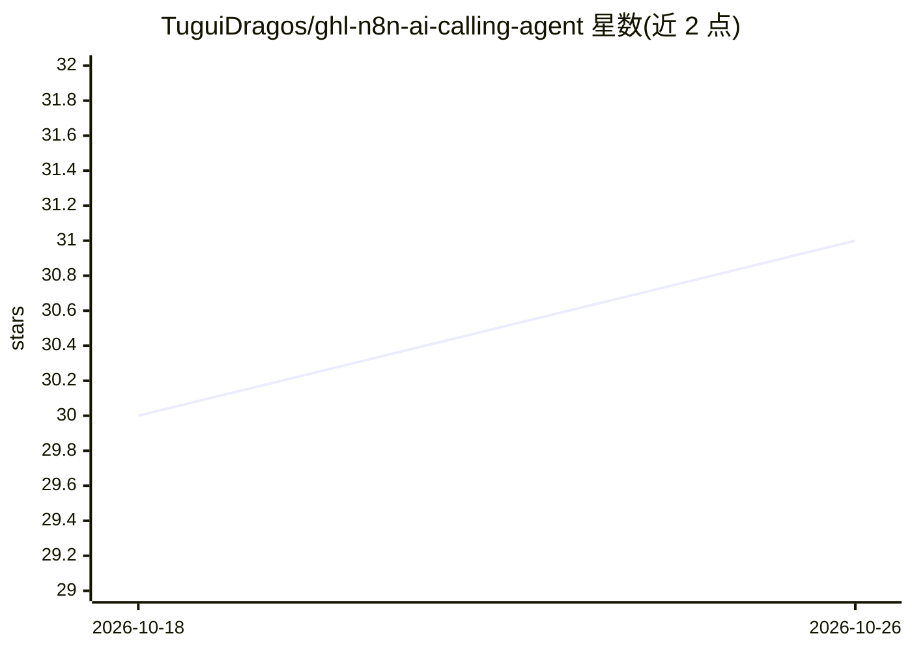

# TuguiDragos/ghl-n8n-ai-calling-agent

⭐ 31 · NOASSERTION · 推送 2026-08-02 · [GitHub](https://github.com/TuguiDragos/ghl-n8n-ai-calling-agent) · [官网](https://n8n.io/workflows/8339-replace-your-call-center-with-an-ai-agent-using-gohighlevel-ghl-vapi-and-twilio/) · 个人维护

**面向 GoHighLevel 的 n8n AI 外呼代理：自动打电话、筛选线索、约日程**

基于 n8n 构建的 24 节点工作流：通过 Vapi 语音代理与 Twilio 电话号码拨打 GoHighLevel 联系人，持有对话、处理异议、经 API 在 GHL 日历中约时间，并将通话摘要、转录与结果标签写回 CRM。每日 9 点启动，单代理约 300 通电话，支持 6 号码轮换、标签锁防重复拨打。附带夜间从 Google Sheets 同步 300-400 条线索的导入工作流。需自备 GHL、n8n、Vapi、Twilio 订阅，每通电话成本 $0.05-0.10。专有许可，完整版在 Gumroad 出售（另有基于 Google Sheets 的 €58.99 精简版）。

## 筛选速览

| 维度 | 判定 | 备注 |
|---|---|---|
| AI 角色 | `ai-native` | 本体是模型或模型工具 |
| 许可风险 | `none` | NOASSERTION |
| 部署形态 | `None` |  |
| 模型依赖 | — | README 未给出锁定关系 |
| 硬件要求 | — | 无带数字的原话,不猜 |
| 安装摩擦 | `low` | 无编译、无系统依赖或容器化 |
| 成熟度 | — | 结构信号不足 |

## 能力要点

- 24 节点 n8n 工作流，单执行测试超 9 小时，单代理日均约 300 通电话
- 标签锁机制防止并行负载下重复拨打同一联系人
- 通话结束自动分类（Interested/Not Interested/Appointment Booked）并写入 GHL
- 夜间从 Google Sheets 同步 300-400 条未处理线索，支持多代理扩展

## 适用场景

- 销售团队自动拨打大量线索电话并直接在日历中预约
- 电话中心/房地产团队替代人工首触外呼
- 通话后自动打标签并触发 SMS/WhatsApp 跟进

## 场景标签

`语音 Agent` `工作流自动化` · 领域:效率与自动化

## 证据(README 行号)

> L14: An AI agent that calls your GoHighLevel contacts, holds the conversation, books the appointment straight into your 
> L135: The agent holds a natural conversation, handles objections and talks to your GHL calendar because of a carefully b

## 星数曲线

2026-10-18 30 → 2026-10-26 31（+1）

---
*卡片 v1 · prompt 1.4 · 生成 2026-10-26 · 置信度 high · 依据 README sha `6f1180b60692` · [字段定义](../../DATASET.md)*
