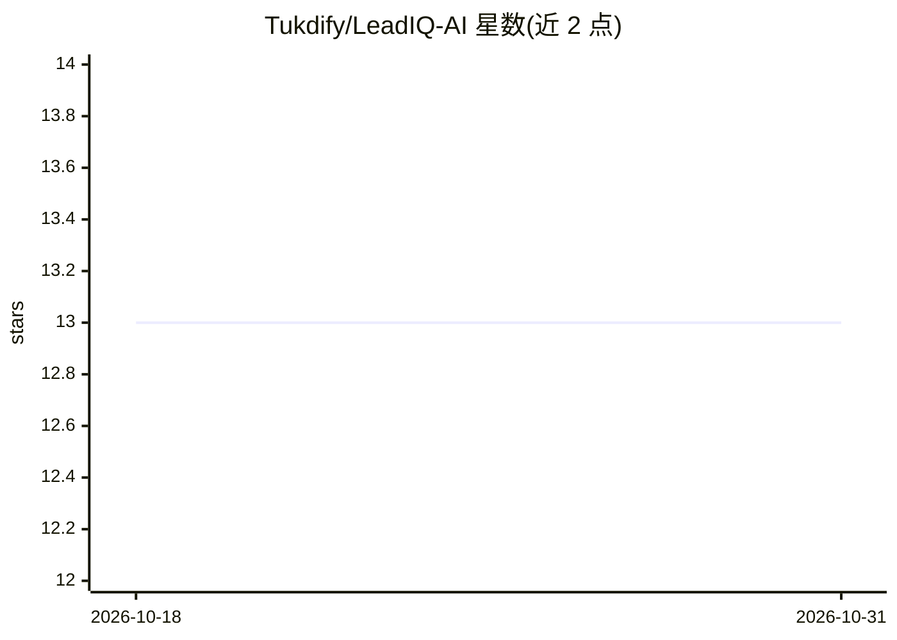

# Tukdify/LeadIQ-AI

⭐ 13 · JavaScript · MIT · 推送 2026-08-30 · [GitHub](https://github.com/Tukdify/LeadIQ-AI) · 个人维护

**面向销售团队的 AI 线索评分与分级路由自动化管线**

基于 n8n 工作流编排的自托管线索资格评定系统：线索经 Webhook 进入后完成数据规范化、Supabase PostgreSQL RPC 的 10 分钟原子去重、调用 Gemini 2.5 Flash 产出 0-100 意向分与结构化推理，按 HOT/WARM/COLD 分级路由到 Slack 告警与 Gmail 跟进邮件，并将全部决策追加到 Google Sheets 审计日志。以 Docker Compose 一键部署，需配置 Gemini、Supabase、Slack、Gmail 等凭据。当前为同步单租户部署，异步队列与 CRM 集成在路线图中。

## 筛选速览

| 维度 | 判定 | 备注 |
|---|---|---|
| AI 角色 | `ai-native` | 本体是模型或模型工具 |
| 许可风险 | `permissive` | MIT |
| 部署形态 | `self-host` | docker 或自建部署 |
| 模型依赖 | — | README 未给出锁定关系 |
| 硬件要求 | — | 无带数字的原话,不猜 |
| 安装摩擦 | `low` | 无编译、无系统依赖或容器化 |
| 成熟度 | — | 结构信号不足 |

## 能力要点

- Gemini 2.5 Flash 评分并输出结构化推理（0-100 分 + 分级）
- Supabase PostgreSQL RPC 实现原子去重（10 分钟窗口）
- HOT→Slack、WARM→Gmail、COLD→仅记录的分级路由矩阵
- Docker Compose 一键部署完整技术栈

## 适用场景

- 销售团队自动分级进入线索并即时通知跟进
- 防止表单重复提交造成的重复 AI 调用与成本浪费
- 在 Google Sheets 中留存每条线索的评分与推理审计记录

## 场景标签

`工作流自动化` · 领域:效率与自动化

## 证据(README 行号)

> L42: |4. AI Qualification|Gemini 2.5 Flash scores intent (0–100) and assigns a tier|
> L101: |🤖 **AI Lead Qualification**|Gemini 2.5 Flash evaluates buyer intent, company fit, urgency, and budget against ICP

## 星数曲线

2026-10-18 13 → 2026-10-31 13（+0）

---
*卡片 v1 · prompt 1.4 · 生成 2026-10-31 · 置信度 high · 依据 README sha `5cead5318c3a` · [字段定义](../../DATASET.md)*
