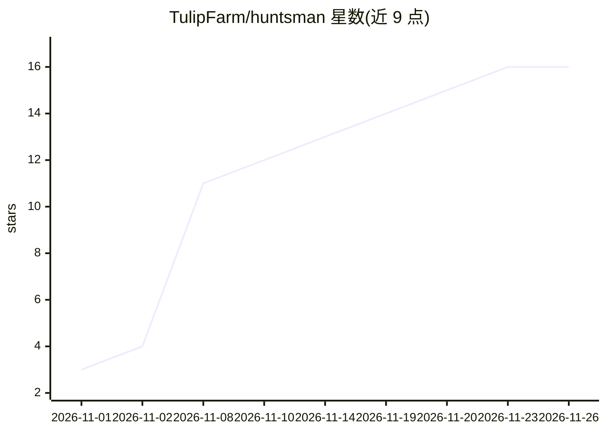

# TulipFarm/huntsman

⭐ 16 · Go · Apache-2.0 · 推送 2026-11-25 · [GitHub](https://github.com/TulipFarm/huntsman) · [官网](https://huntsman.tulipfarm.ai) · 个人维护

**自托管网页抓取服务：把任意页面转为干净 Markdown 供 LLM/agent 使用**

单个 Go 二进制的自托管抓取服务：用 Lightpanda 渲染 JavaScript，按 Firecrawl 的 onlyMainContent 规则与 EasyList 过滤列表去除导航/广告/横幅，输出 Markdown。提供 Firecrawl 兼容的 /v1/scrape、batch、crawl REST API 及内置 MCP 端点（5 个工具），SQLite 队列支持批量与整站抓取，默认阻止私网地址、遵循 robots.txt、支持 Bearer token。安装脚本免 sudo，Windows/服务器提供 Docker 镜像。仅输出 Markdown 与链接，不含截图、HTML、JSON 提取等功能。

## 筛选速览

| 维度 | 判定 | 备注 |
|---|---|---|
| AI 角色 | `ai-ecosystem` | LLM/agent 周边工具 |
| 许可风险 | `permissive` | Apache-2.0 |
| 部署形态 | `self-host` | docker 或自建部署 |
| 模型依赖 | — | README 未给出锁定关系 |
| 硬件要求 | — | 无带数字的原话,不猜 |
| 安装摩擦 | `low` | 无编译、无系统依赖或容器化 |
| 成熟度 | — | 结构信号不足 |

## 能力要点

- Firecrawl 兼容 /v1 API 与内置 MCP 端点（scrape/batch/crawl/get_job/get_crawl）
- Lightpanda 渲染 JavaScript，PDF 直接抓取，被反爬页面回退为纯 HTML 重试
- SQLite 队列支持单批最多 1,000 URL 与整站爬取，带按主机并发限制与结果缓存
- 私有地址拦截、robots.txt 遵循、非 root 运行与命名 Bearer token

## 适用场景

- 给 Claude Code/Cursor 等 agent 接入网页读取能力
- 为 LLM 管线批量转换网页为低 token 成本的 Markdown
- 整站爬取并缓存结果用于检索或分析

## 场景标签

`网页抓取` · 领域:效率与自动化

## 证据(README 行号)

> L18: and serves a Firecrawl-compatible `/v1/scrape` API and an MCP server from one Go binary. Run it on your machine and
> L118: Huntsman has a built-in MCP server at `/mcp`, using the Streamable HTTP transport, so
> L148: Point your client at Huntsman's base URL and keep using `/v1/scrape`. Huntsman deliberately does less: it returns

## 星数曲线

2026-11-01 3 → 2026-11-26 16（+13）

---
*卡片 v1 · prompt 1.4 · 生成 2026-11-18 · 置信度 high · 依据 README sha `0df3fc5c67be` · [字段定义](../../DATASET.md)*
