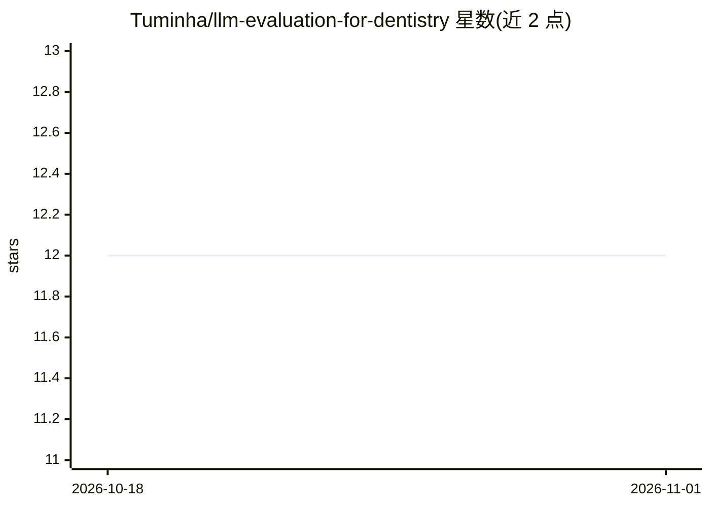

# Tuminha/llm-evaluation-for-dentistry

⭐ 12 · Python · MIT · 推送 2026-07-16 · [GitHub](https://github.com/Tuminha/llm-evaluation-for-dentistry) · [官网](https://periospot.com) · 个人维护

**牙科临床知识的 LLM 可复现基准评测（30 题、6 领域）**

由牙周病学医师编写并经指南核验的临床牙科问题基准：30 道题覆盖牙周病学、种植、口腔-全身医学、药理与患者沟通 6 个领域，每题带 must_include/must_avoid 评分规则。流水线经 OpenRouter 单一网关让各模型作答，LLM 裁判评分并记录拒答、一致性与延迟，另用第二裁判测量裁判偏差（Cohen's kappa）。限制：n=30、每题 1 次试验、裁判相关绝对值不可比。提供 Python 脚本复现与扩展。

## 筛选速览

| 维度 | 判定 | 备注 |
|---|---|---|
| AI 角色 | `ai-ecosystem` | LLM/agent 周边工具 |
| 许可风险 | `permissive` | MIT |
| 部署形态 | `library` | 以包/库形式分发 |
| 模型依赖 | locked-api |  |
| 硬件要求 | — | 无带数字的原话,不猜 |
| 安装摩擦 | `low` | 无编译、无系统依赖或容器化 |
| 成熟度 | — | 结构信号不足 |

## 能力要点

- 牙周医师编写、指南核验的 30 题 × 6 临床领域数据集（含显式评分 rubric）
- 经 OpenRouter 单一网关跨 8 个模型运行，支持 anthropic/openai 直连后端
- LLM 裁判评分 + 独立第二裁判偏差测量（kappa 报告）
- 拒答单独归类，同时报告部署视角准确率与已答题准确率

## 适用场景

- 比较主流 LLM 在牙科临床问题上的准确率
- 复现或扩展临床领域 LLM 基准评测流程
- 审查模型在药理等高风险领域的临床错误

## 场景标签

`模型评测` · 领域:评测与运维

## 证据(README 行号)

> L10: A reproducible benchmark that measures how well current large language models answer
> L31: This repo is that missing benchmark: a periodontist-authored question set with explicit
> L61: 1. **Generation** — every model answers every question through OpenRouter

## 星数曲线

2026-10-18 12 → 2026-11-01 12（+0）

---
*卡片 v1 · prompt 1.4 · 生成 2026-11-01 · 置信度 mid · 依据 README sha `3bccd9eb6d75` · [字段定义](../../DATASET.md)*
