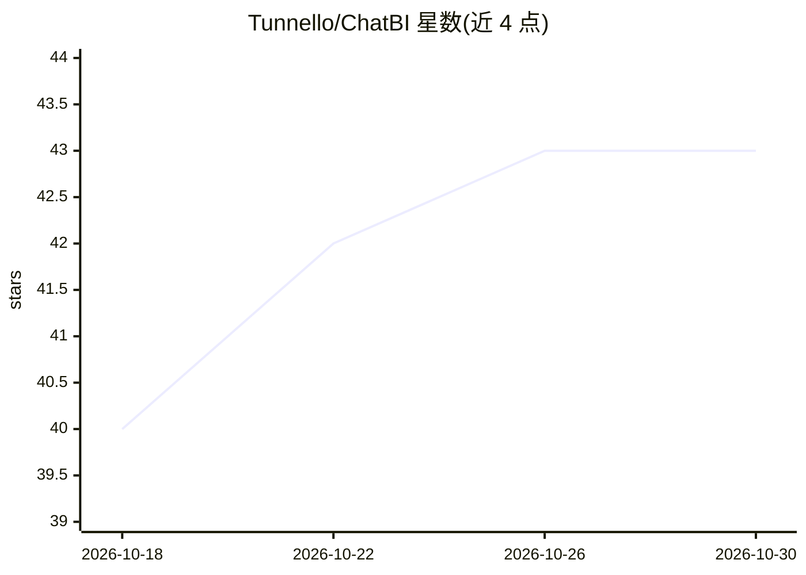

# Tunnello/ChatBI

⭐ 43 · TypeScript · MIT · 推送 2026-05-01 · [GitHub](https://github.com/Tunnello/ChatBI) · 组织维护 · 中文 README

**自然语言查询本地 SQLite 的对话式 BI Agent，自动生成 SQL 与图表**

基于 LangGraph 的对话式数据分析应用：用户用中英文提问，Agent 通过 RAG 检索表 Schema、生成 SQL、在本地 SQLite 执行并自动生成 ECharts 图表，支持多轮上下文记忆、SQL 错误诊断修复建议、SSE 流式输出与 MCP 工具调用日志可视化。模型使用阿里百炼 Qwen 系列（OpenAI 兼容接口），前端 React 19 + Ant Design，后端 FastAPI + Python 3.12+，向量库 ChromaDB。需配置 API Key，含可选的 Streamlit 旧架构（已标记弃用）。

## 筛选速览

| 维度 | 判定 | 备注 |
|---|---|---|
| AI 角色 | `ai-native` | 本体是模型或模型工具 |
| 许可风险 | `permissive` | MIT |
| 部署形态 | `library` | 以包/库形式分发 |
| 模型依赖 | — | README 未给出锁定关系 |
| 硬件要求 | — | 无带数字的原话,不猜 |
| 安装摩擦 | `low` | 无编译、无系统依赖或容器化 |
| 成熟度 | — | 结构信号不足 |

## 能力要点

- 自然语言转 SQL 并在本地 SQLite 执行
- RAG 检索表 Schema（ChromaDB 向量库）
- 自动识别图表需求并生成多种 ECharts 图表
- MCP 工具调用日志可视化与 SQL 错误自愈建议

## 适用场景

- 不写 SQL 用对话查询业务数据并出图表
- 数据分析与报表生成的对话式入口
- 观察 MCP 工具调用过程用于调试

## 场景标签

`数据分析` · 领域:效率与自动化

## 证据(README 行号)

> L4: ChatBI (Chat Business Intelligence) 是一个基于 LangGraph 的智能数据对话 Agent，支持自然语言与本地 SQLite 数据库交互，自动生成 SQL 查询并可视化结果。适用于数据分析、报
> L20: - **自然语言转 SQL**：输入中文或英文问题，自动生成并执行 SQL 查询
> L51: - **AI 模型**：阿里百炼 Qwen 系列

## 星数曲线

2026-10-18 40 → 2026-10-30 43（+3）

---
*卡片 v1 · prompt 1.4 · 生成 2026-10-25 · 置信度 high · 依据 README sha `cab755d21c7e` · [字段定义](../../DATASET.md)*
