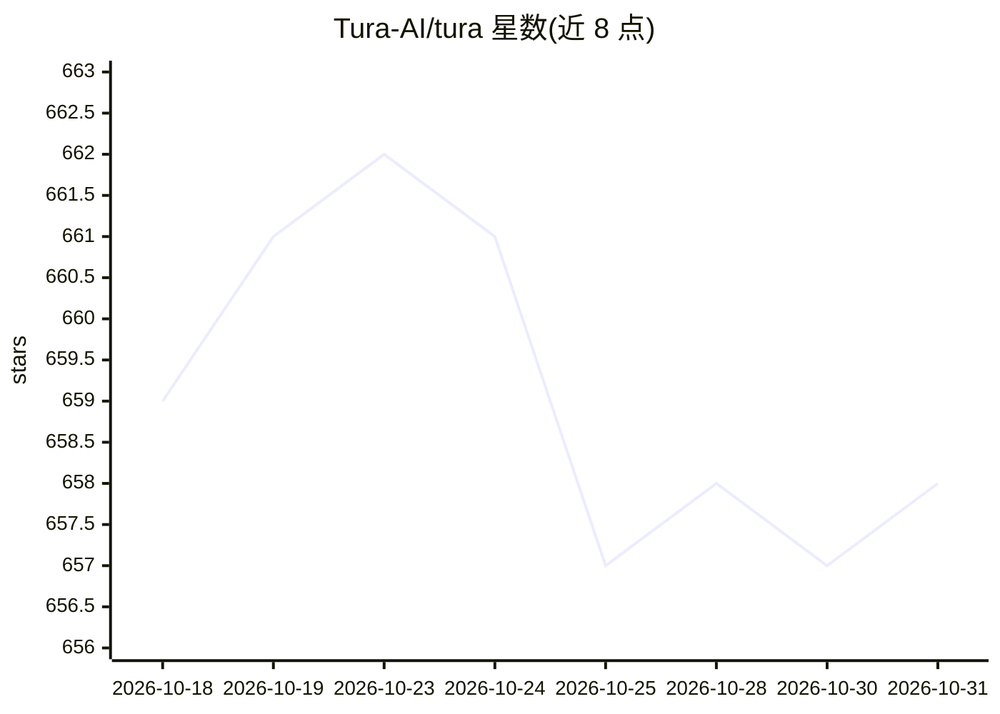

# Tura-AI/tura

⭐ 658 · Rust · AGPL-3.0 · 推送 2026-10-07 · [GitHub](https://github.com/Tura-AI/tura) · [官网](https://turaai.net/) · 组织维护 · 中文 README

**面向开发者的终端编码 agent，以更少 token 轮次执行任务**

开源 agent 运行时 harness，用 Rust 编写，通过单一 command_run 宏工具将多步命令组织为运行时管理的执行树，减少模型往返轮次；配合反向推理引导、task_status 状态机与递归任务手册做上下文管理。README 公布与 Codex CLI 的基准对比（20 个 DeepSWE 任务）：Balanced 成功率 80.0%、token 少 31.1%；Direct token 少 77.5%。提供 npm 全局/项目安装、源码脚本安装，入口含 TUI、CLI、本地 HTTP/SSE gateway 与桌面 GUI；不内置 provider 凭据，首次需配置 LLM provider。已声明多处证据缺口（跨 provider、跨 OS 等）。

## 筛选速览

| 维度 | 判定 | 备注 |
|---|---|---|
| AI 角色 | `ai-native` | 本体是模型或模型工具 |
| 许可风险 | `viral` | AGPL-3.0 |
| 部署形态 | `desktop` | 安装包/桌面程序 |
| 模型依赖 | — | README 未给出锁定关系 |
| 硬件要求 | — | 无带数字的原话,不猜 |
| 安装摩擦 | `low` | 无编译、无系统依赖或容器化 |
| 成熟度 | — | 结构信号不足 |

## 能力要点

- command_run 宏工具：一次 LLM 轮次执行多步命令树
- task_status 运行时状态机做任务级上下文管理与压缩
- TUI / CLI / 本地 gateway / 桌面 GUI 多入口
- npm 安装无 postinstall 脚本，wrapper 直接启动平台包

## 适用场景

- 在终端用自然语言驱动多步编码、构建与测试工作流
- 长程任务中控制上下文膨胀与 token 成本
- 通过本地 gateway 以 HTTP/SSE 接入会话

## 场景标签

`编码 Agent` · 领域:编码与开发

## 证据(README 行号)

> L13: Tura is an open-source agent runtime harness that delivers better results with fewer tokens.
> L21: Across 20 DeepSWE v1.1 tasks, each run three times per agent, Tura creates a substantial token-budget advantage by 

## 星数曲线

2026-10-18 659 → 2026-10-31 658（-1）

---
*卡片 v1 · prompt 1.4 · 生成 2026-10-22 · 置信度 high · 依据 README sha `bb22ba101a0e` · [字段定义](../../DATASET.md)*
