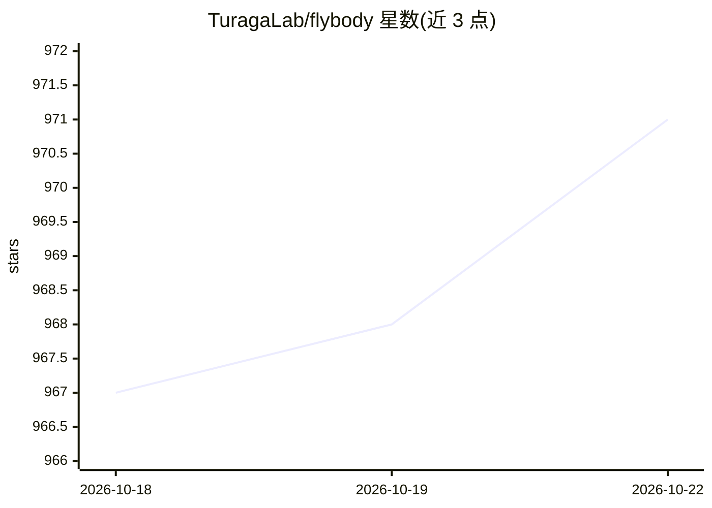

# TuragaLab/flybody

⭐ 972 · Python · Apache-2.0 · 推送 2026-02-07 · [GitHub](https://github.com/TuragaLab/flybody) · 组织维护

**果蝇解剖级 MuJoCo 身体模型与运动 RL 任务集**

提供用于 MuJoCo 物理仿真和强化学习的黑腹果蝇解剖级身体模型，由 Google DeepMind 与 HHMI Janelia 合作开发。包含飞行、行走、视觉引导飞行等 RL 任务环境，配套教程 notebook 与 Colab。训练部分通过可选 ML 扩展（Tensorflow、Acme）与 Ray 扩展（分布式 DMPO 训练）提供；核心安装不含 ML 依赖，策略推理与训练不自动支持。conda 环境建议安装 cudatoolkit=11.8。

## 筛选速览

| 维度 | 判定 | 备注 |
|---|---|---|
| AI 角色 | `ai-native` | 本体是模型或模型工具 |
| 许可风险 | `permissive` | Apache-2.0 |
| 部署形态 | `library` | 以包/库形式分发 |
| 模型依赖 | — | README 未给出锁定关系 |
| 硬件要求 | — | 无带数字的原话,不猜 |
| 安装摩擦 | `low` | 无编译、无系统依赖或容器化 |
| 成熟度 | — | 结构信号不足 |

## 能力要点

- 果蝇解剖级 MuJoCo 身体模型（fruitfly.xml 可在 simulate 查看器可视化）
- 飞行、行走、视觉引导飞行 RL 任务环境
- Ray 分布化 DMPO 训练脚本
- 核心/ML/Ray 三档 pip 安装模式

## 适用场景

- 果蝇生物物理仿真与传感器运动行为的神经控制建模
- 在 MuJoCo 中做果蝇运动强化学习训练
- 快速上手教程 notebook 与 Colab 实验

## 场景标签

`强化学习` `教程课程` · 领域:学习与行业

## 证据(README 行号)

> L11: `flybody` is an anatomically-detailed body model of the fruit fly [_Drosophila melanogaster_][drosophila_wikipedia]
> L15: We envision our model as a platform for fruit fly biophysics simulations and for modeling neural control of sensori
> L34: To train the fly, try the [distributed RL training script][ray-script], which uses [Ray][ray] to parallelize the [D

## 星数曲线

2026-10-18 967 → 2026-10-22 971（+4）

---
*卡片 v1 · prompt 1.4 · 生成 2026-10-21 · 置信度 high · 依据 README sha `39fa2491f376` · [字段定义](../../DATASET.md)*
