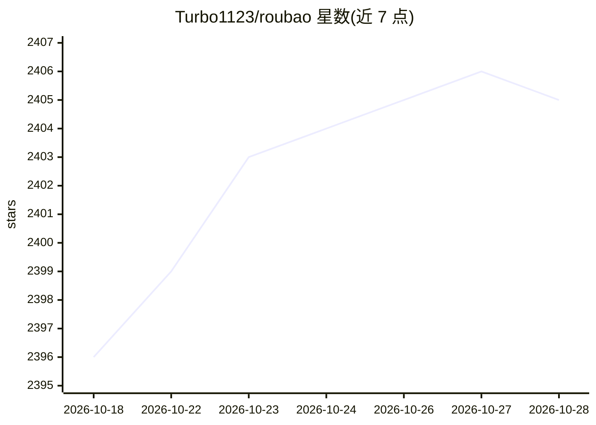

# Turbo1123/roubao

⭐ 2,403 · Kotlin · MIT · 推送 2026-01-08 · [GitHub](https://github.com/Turbo1123/roubao) · 个人维护 · 中文 README

**无需电脑的开源 AI 手机自动化助手（Android App）**

用 Kotlin 原生实现的 Android 手机自动化 App，基于视觉语言模型（VLM）看懂屏幕并根据自然语言指令自动操作手机。采用受 Claude Code 启发的 Tools + Skills 双层 Agent 架构，支持 Delegation（DeepLink 调用有 AI 能力的 App）与 GUI 自动化（截图-分析-操作循环）两种模式。通过 Shizuku 获得 ADB 级权限，无需 Root、无需电脑。用户需自备 VLM API Key（阿里云、OpenAI、OpenRouter 等，也支持 Ollama、vLLM 自定义端点），APK 安装即用，要求 Android 8.0+。

## 筛选速览

| 维度 | 判定 | 备注 |
|---|---|---|
| AI 角色 | `ai-native` | 本体是模型或模型工具 |
| 许可风险 | `permissive` | MIT |
| 部署形态 | `None` |  |
| 模型依赖 | local-ok | 支持本地模型 |
| 硬件要求 | — | 无带数字的原话,不猜 |
| 安装摩擦 | `medium` | 含编译或系统依赖之一 |
| 成熟度 | — | 结构信号不足 |

## 能力要点

- Kotlin 原生 Android 实现，截图、分析、执行全程在手机本地完成
- Tools + Skills 双层 Agent 架构，支持 Delegation 与 GUI 自动化两种执行模式
- 通过 Shizuku 获取 ADB 级权限，无需 Root，无需电脑
- API Key AES-256-GCM 加密存储，支付/密码等敏感页面自动停止

## 适用场景

- 用一句话让手机自动点外卖、发微信、导航
- 不连电脑、不装 Python 环境在手机上跑 GUI 自动化
- 配置自有 VLM API（含本地 Ollama/vLLM 端点）驱动手机 Agent

## 场景标签

`GUI 自动化` · 领域:效率与自动化

## 证据(README 行号)

> L7:  基于视觉语言模型 (VLM) · 原生 Android Kotlin · 多 Agent 协作架构
> L139: - 基于先进的视觉语言模型（VLM），能够"看懂"屏幕内容

## 星数曲线

2026-10-18 2,396 → 2026-10-28 2,405（+9）

---
*卡片 v1 · prompt 1.4 · 生成 2026-10-21 · 置信度 high · 依据 README sha `20210d959497` · [字段定义](../../DATASET.md)*
