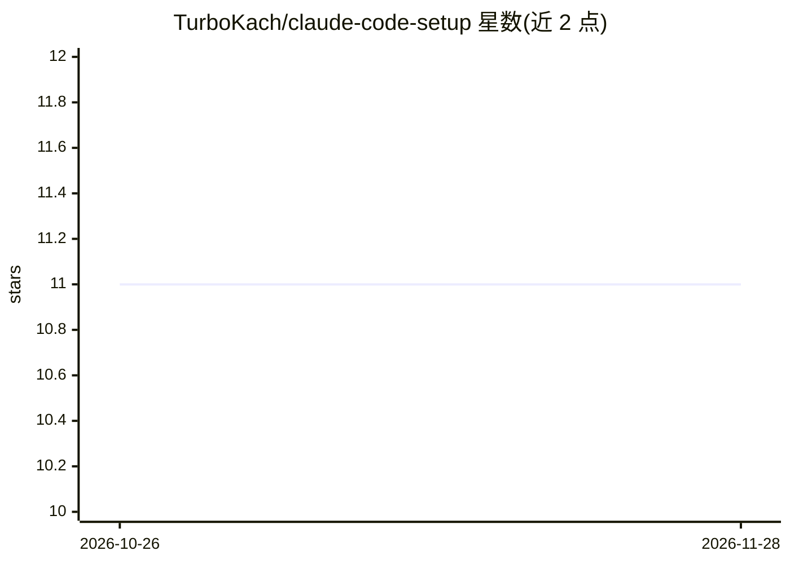

# TurboKach/claude-code-setup

⭐ 11 · Python · MIT · 推送 2026-11-18 · [GitHub](https://github.com/TurboKach/claude-code-setup) · 个人维护

**Claude Code 多智能体编排配置套件：规划→执行→评审→合并流水线**

面向 Claude Code 用户的配置与技能包：包含一份 CLAUDE.md 原则层、按需加载的路径规则、六阶段特性流水线技能（规划→委派执行→codex 交叉评审→交付）、八个固定角色的子代理定义（探索/计划评审/执行/修复/评审/合并等），以及后台子代理并行扇出机制。提供 install.sh 一键安装到 ~/.claude（含备份与设置合并）、自更新技能与更新检查钩子。默认模型分工为 Opus 规划评审、Sonnet 编码执行，扇出会显著增加 token 消耗。

## 筛选速览

| 维度 | 判定 | 备注 |
|---|---|---|
| AI 角色 | `ai-ecosystem` | LLM/agent 周边工具 |
| 许可风险 | `permissive` | MIT |
| 部署形态 | `None` |  |
| 模型依赖 | locked-api |  |
| 硬件要求 | — | 无带数字的原话,不猜 |
| 安装摩擦 | `low` | 无编译、无系统依赖或容器化 |
| 成熟度 | — | 结构信号不足 |

## 能力要点

- 六阶段特性流水线：plan → 委派执行 → codex 交叉评审 → 交付
- 八个固定角色子代理与并行扇出（worktree 隔离仅用于并行写入）
- install.sh 一键安装、自更新技能与每日更新检查钩子
- 模型分工配置：Opus 规划/评审，Sonnet 执行/修复

## 适用场景

- 为 Claude Code 配置多子代理并行开发流水线
- 在特性开发中引入计划评审与对抗式代码评审门禁
- 需要会话启动钩子、更新检查等自动化运维机制

## 场景标签

`多智能体` `编码 Agent` `代码审查` · 领域:Agent 开发

## 证据(README 行号)

> L3: My Claude Code setup: an opinionated `CLAUDE.md`, plus
> L22: |`skills/feature-workflow/SKILL.md`|The six-stage single-master feature pipeline, the parallel-multi-agent mechanis
> L41: |`install.sh`|Copies everything into `~/.claude` (with backups) and merges the settings keys above|

## 星数曲线

2026-10-26 11 → 2026-11-28 11（+0）

---
*卡片 v1 · prompt 1.4 · 生成 2026-11-18 · 置信度 high · 依据 README sha `6c7dba655545` · [字段定义](../../DATASET.md)*
