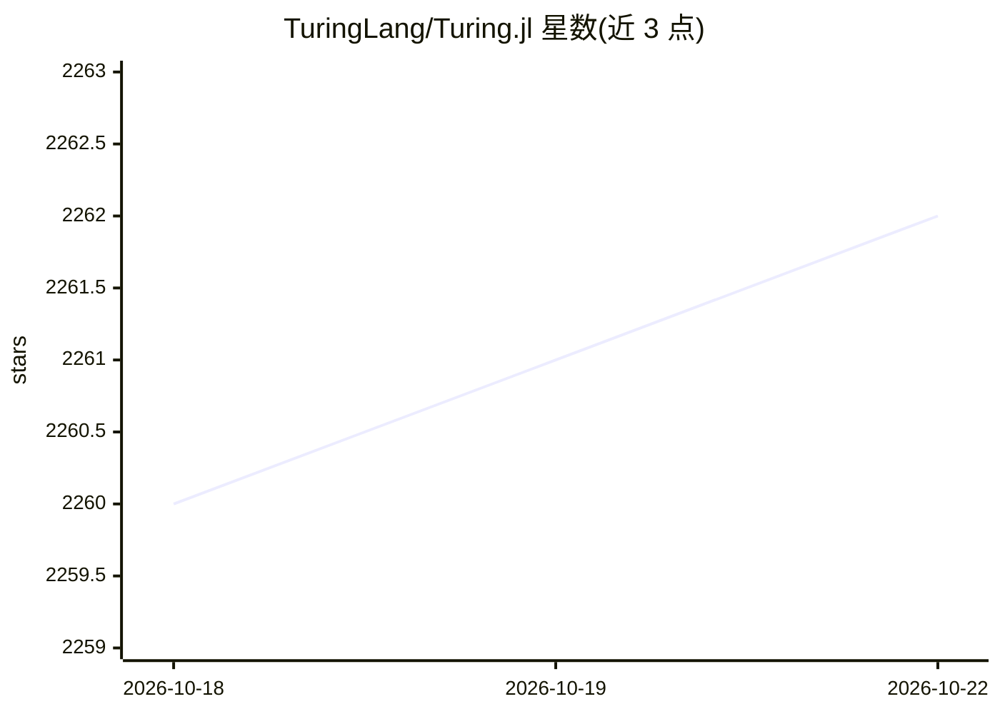

# TuringLang/Turing.jl

⭐ 2,261 · Julia · MIT · 推送 2026-10-19 · [GitHub](https://github.com/TuringLang/Turing.jl) · [官网](https://turinglang.org) · 组织维护

**Julia 概率编程包，做贝叶斯与似然推断**

用 Julia 实现的通用概率编程库，面向统计建模与贝叶斯推断用户。模型可用 @model 宏、BUGS 语法（JuliaBUGS.jl）或图形方式（DoodlePPL）定义，支持 MCMC、变分推断、最大似然与 MAP 估计，并可通过 log-density 与梯度接口定制推断。默认自动微分后端为 ForwardDiff.jl 与 Mooncake.jl，其他后端（如 Enzyme.jl）经 DifferentiationInterface.jl 接入。安装需 Julia 1.10.8+，属资助支持的科研软件，优先保证正确性与稳定性。

## 筛选速览

| 维度 | 判定 | 备注 |
|---|---|---|
| AI 角色 | `ai-native` | 本体是模型或模型工具 |
| 许可风险 | `permissive` | MIT |
| 部署形态 | `None` |  |
| 模型依赖 | — | README 未给出锁定关系 |
| 硬件要求 | — | 无带数字的原话,不猜 |
| 安装摩擦 | `low` | 无编译、无系统依赖或容器化 |
| 成熟度 | — | 结构信号不足 |

## 能力要点

- 支持 MCMC、变分推断、最大似然与 MAP 估计
- 多种模型定义方式：@model 宏、BUGS 语法（JuliaBUGS.jl）、图形（DoodlePPL）
- 通过 log-density 和梯度接口支持自定义推断
- 可切换自动微分后端（ForwardDiff/Mooncake/Enzyme）

## 适用场景

- 在 Julia 中定义贝叶斯模型并做后验采样
- 科研工作中复现与扩展概率推断方法
- 为梯度类推断算法更换自动微分后端

## 场景标签

 · 领域:科学计算/统计机器学习

## 证据(README 行号)

> L11: `Turing.jl` is a general-purpose probabilistic programming package for Bayesian and
> L65: Turing is grant-funded research software that prioritises correctness and stability

## 星数曲线

2026-10-18 2,260 → 2026-10-22 2,262（+2）

---
*卡片 v1 · prompt 1.4 · 生成 2026-10-21 · 置信度 high · 依据 README sha `130d30e9061c` · [字段定义](../../DATASET.md)*
