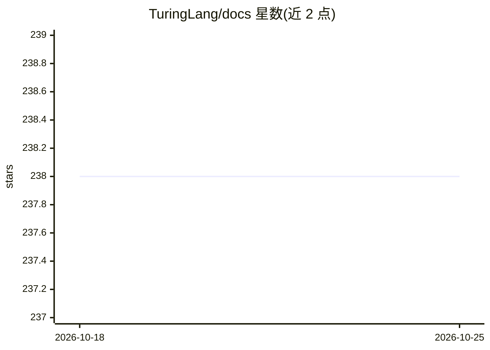

# TuringLang/docs

⭐ 238 · Markdown · MIT · 推送 2026-09-20 · [GitHub](https://github.com/TuringLang/docs) · [官网](https://turinglang.org/docs/) · 组织维护

**Turing.jl 概率编程语言的官方文档与教程仓库**

Turing.jl（Julia 生态的贝叶斯推断概率编程语言）的文档与教程源码仓库，渲染为官网 turinglang.org/docs。内容覆盖使用文档与教程，用 Quarto 构建，支持本地预览、单文件渲染与通过 _freeze 缓存文件夹加速构建（完整渲染需数小时）。面向希望阅读或贡献 Turing.jl 文档的用户与贡献者，MIT 许可。

## 筛选速览

| 维度 | 判定 | 备注 |
|---|---|---|
| AI 角色 | `ai-knowledge` | 知识聚合/清单类 |
| 许可风险 | `permissive` | MIT |
| 部署形态 | `None` |  |
| 模型依赖 | — | README 未给出锁定关系 |
| 硬件要求 | — | 无带数字的原话,不猜 |
| 安装摩擦 | `low` | 无编译、无系统依赖或容器化 |
| 成熟度 | — | 结构信号不足 |

## 能力要点

- Turing.jl 官方文档与教程的源码，发布于 turinglang.org/docs
- Quarto 构建，支持本地预览与单文件渲染
- _freeze 缓存机制加速完整站点构建

## 适用场景

- 查阅 Turing.jl 的使用文档与贝叶斯建模教程
- 本地渲染文档站点以离线阅读或预览修改
- 为 Turing.jl 文档贡献内容

## 场景标签

`教程课程` · 领域:学习与行业

## 证据(README 行号)

> L3:  Bayesian inference with probabilistic programming
> L5: # Turing.jl Documentation and Tutorials

## 星数曲线

2026-10-18 238 → 2026-10-25 238（+0）

---
*卡片 v1 · prompt 1.4 · 生成 2026-10-22 · 置信度 high · 依据 README sha `0468602193ff` · [字段定义](../../DATASET.md)*
