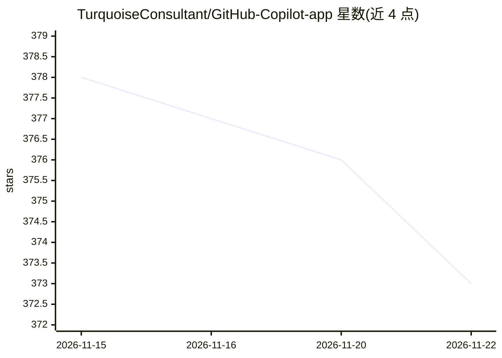

# TurquoiseConsultant/GitHub-Copilot-app

⭐ 373 · Apache-2.0 · 推送 2026-11-15 · [GitHub](https://github.com/TurquoiseConsultant/GitHub-Copilot-app) · 组织维护

**面向开发者的 GitHub Copilot 桌面应用：跨仓库查找、运行与交付软件工作**

GitHub 官方维护的 agent 桌面应用，用于管理从想法到拉取请求的软件工作：本地会话运行在相互隔离的 git worktree 中，云端会话运行在 GitHub 托管的隔离环境；提供 Canvas 可视化查看与编辑 agent 的工作过程（计划、终端、预览、diff），My Work 聚合会话、issue 与拉取请求，Automations 将提示词转为定时/后台任务，Agent Merge 辅助拉取请求走完审查、检查与合并流程。需要 Git 和任意 Copilot 订阅，也支持自带密钥（BYOK）接入自有模型提供商。通过 Releases 页面或下载链接获取安装包。

## 筛选速览

| 维度 | 判定 | 备注 |
|---|---|---|
| AI 角色 | `ai-ecosystem` | LLM/agent 周边工具 |
| 许可风险 | `permissive` | Apache-2.0 |
| 部署形态 | `desktop` | 安装包/桌面程序 |
| 模型依赖 | — | README 未给出锁定关系 |
| 硬件要求 | — | 无带数字的原话,不猜 |
| 安装摩擦 | `low` | 无编译、无系统依赖或容器化 |
| 成熟度 | — | 结构信号不足 |

## 能力要点

- 本地会话各自运行在隔离的 git worktree，云端会话运行在 GitHub 托管隔离环境
- Canvas 将 agent 的计划、终端、预览、diff 与工作流状态呈现为可检查、可编辑的界面
- Automations 将可重复的提示词与工作流转为定时或后台任务
- Agent Merge 辅助拉取请求通过审查、检查与合并条件

## 适用场景

- 并行运行多个 agent 分别处理 bug 调查、issue 实现与审查反馈
- 在单一控制中心管理跨仓库的会话、issue 与拉取请求
- 将重复性提示词固化为定时或后台自动化任务

## 场景标签

`编码 Agent` `代码审查` · 领域:编码与开发

## 证据(README 行号)

> L13: The GitHub Copilot app is an agent-native desktop experience for managing software work from idea to pull request. 
> L15: The app is built for parallel agent-driven development. Each local session runs in its own isolated git worktree, a
> L26: - A GitHub Copilot plan — any plan works, including Copilot Free and GitHub Copilot Student. No Copilot plan? You c

## 星数曲线

2026-11-15 378 → 2026-11-22 373（-5）

---
*卡片 v1 · prompt 1.4 · 生成 2026-11-17 · 置信度 high · 依据 README sha `f4e4cad8cfa9` · [字段定义](../../DATASET.md)*
