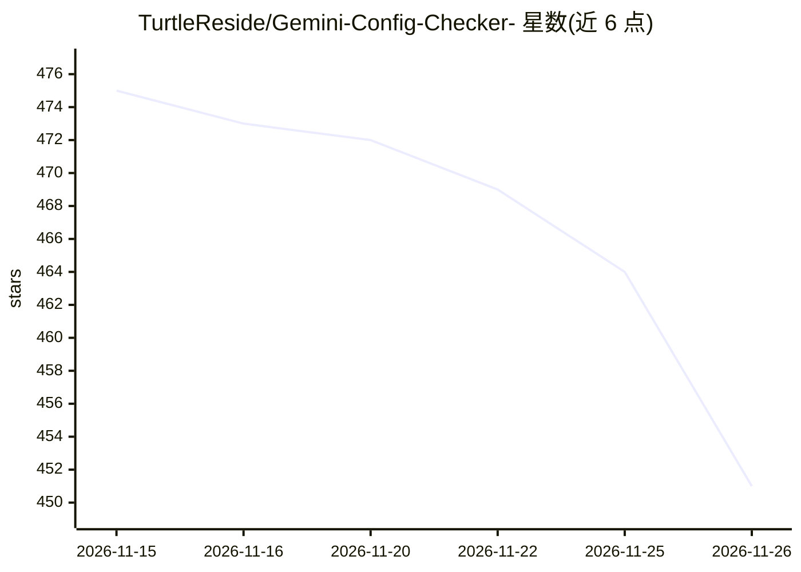

# TurtleReside/Gemini-Config-Checker-

⭐ 451 · Go · Apache-2.0 · 推送 2026-11-15 · [GitHub](https://github.com/TurtleReside/Gemini-Config-Checker-) · 个人维护

**扫描代理配置能否真正进入 Google AI Studio 与 Gemini 的桌面/移动工具**

面向需要经代理访问 Gemini 与 AI Studio 的用户：批量测试 vless/vmess/trojan/ss 等配置，通过独立的已登录浏览器读取 Google 的区域判定（约 20-40 秒/配置），而非仅做连通性探测。提供 Simple（直测自有配置）与 Advanced（基础配置后链免费配置换出口）两种模式，内置嵌入的 Xray-core 引擎与可编辑的 anti-DPI 分片配置。以 Wails 桌面应用（Windows/macOS/Linux）、Android APK 与 Web 服务器三种形态发布。自述为 0.1.0 早期预发布，仅 Windows 经过端到端实测；区域检查需 Chrome/Edge/Brave，Android 仅支持连通性模式。

## 筛选速览

| 维度 | 判定 | 备注 |
|---|---|---|
| AI 角色 | `ai-ecosystem` | LLM/agent 周边工具 |
| 许可风险 | `permissive` | Apache-2.0 |
| 部署形态 | `desktop` | 安装包/桌面程序 |
| 模型依赖 | — | README 未给出锁定关系 |
| 硬件要求 | — | 无带数字的原话,不猜 |
| 安装摩擦 | `medium` | 含编译或系统依赖之一 |
| 成熟度 | `idea` | |

## 能力要点

- 已登录浏览器读取 Google 对 AI Studio/Gemini 的真实区域判定
- Simple/Advanced 双模式，Advanced 支持基础配置+免费配置链式组合
- 可编辑 anti-DPI 配置（fragment 分片、指纹、ALPN、密码套件）
- Windows/macOS/Linux 桌面版、Android APK 与 Web 服务器三种发布形态

## 适用场景

- 测试手头的代理配置哪些能真正打开 Gemini 和 AI Studio
- Cloudflare 配置能连但被 Google 区域封锁时，寻找可用的链式出口
- 批量扫描免费配置列表并导出可用的链接/base64/Xray 配置

## 场景标签

 · 领域:网络工具/代理配置检测

## 证据(README 行号)

> L11: Find proxy configs that actually get you into **Google AI Studio and Gemini**, by testing each one the way a person
> L50: Google decides region availability **per signed-in account, after the page has loaded**. A plain HTTP request (even

## 星数曲线

2026-11-15 475 → 2026-11-26 451（-24）

---
*卡片 v1 · prompt 1.4 · 生成 2026-11-17 · 置信度 mid · 依据 README sha `846e83cebb20` · [字段定义](../../DATASET.md)*
