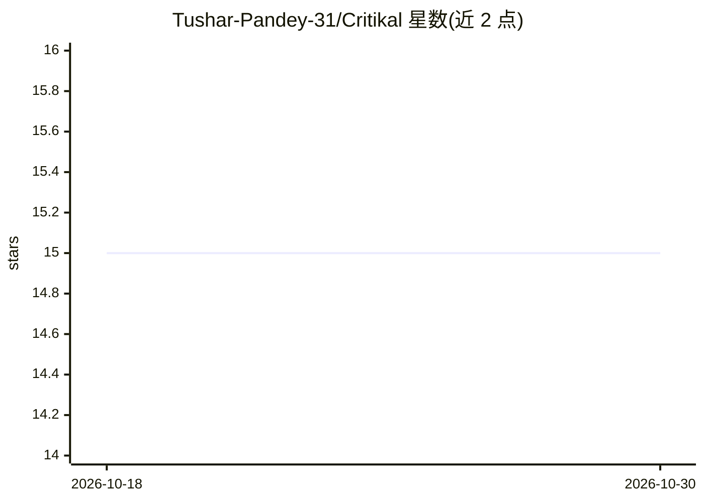

# Tushar-Pandey-31/Critikal

⭐ 15 · Python · MIT · 推送 2026-05-09 · [GitHub](https://github.com/Tushar-Pandey-31/Critikal) · [官网](https://critikalai.com) · 个人维护

**自主智能合约安全审计 agent：定位漏洞并生成 Foundry PoC**

面向安全研究者的智能合约审计自动化 agent：输入仓库 URL 后，依次完成仓库摄取（Slither + 知识图）、协议侦察（文档/NatSpec/Etherscan 链上数据）、攻击面热点评分、攻击假设生成、四门预过滤与多模型陪审团辩论验证，最终生成带自纠错的 Foundry PoC 测试和 HTML/Markdown 审计报告。默认路由 xAI 与 OpenAI 模型，各角色可切换 claude/gemini/openrouter；需 Poetry、Foundry、solc-select、Node.js 等依赖，也提供 Docker 镜像捆绑全部环境。

## 筛选速览

| 维度 | 判定 | 备注 |
|---|---|---|
| AI 角色 | `ai-native` | 本体是模型或模型工具 |
| 许可风险 | `permissive` | MIT |
| 部署形态 | `self-host` | docker 或自建部署 |
| 模型依赖 | locked-api |  |
| 硬件要求 | — | 无带数字的原话,不猜 |
| 安装摩擦 | `low` | 无编译、无系统依赖或容器化 |
| 成熟度 | — | 结构信号不足 |

## 能力要点

- 摄取→侦察→热点映射→假设→多门验证→PoC 证明→报告的七阶段流水线
- 生成 Foundry PoC 测试文件（含自纠错）与 Immunefi/HackerOne 可提交的 Markdown 报告
- 4 档流水线模式（fast/standard/deep/semantic_only）与按角色可覆盖的多模型路由
- 多模型陪审团（Skeptic/Attacker/Auditor/Judge）决策验证机制

## 适用场景

- 对授权目标的智能合约仓库做自动化漏洞挖掘与 PoC 验证
- 生成可提交漏洞赏金平台的审计报告与证明文件
- 安全研究者用多模型辩论机制复核可疑漏洞假设

## 场景标签

`网络安全` · 领域:学习与行业

## 证据(README 行号)

> L10: Critikal thinks like an attacker. Give it a repository URL and it will autonomously find real, exploitable vulnerab
> L21: 6. **Proves** (Foundry PoC test generation with self-correction)

## 星数曲线

2026-10-18 15 → 2026-10-30 15（+0）

---
*卡片 v1 · prompt 1.4 · 生成 2026-10-30 · 置信度 mid · 依据 README sha `f9ebe2f5637c` · [字段定义](../../DATASET.md)*
