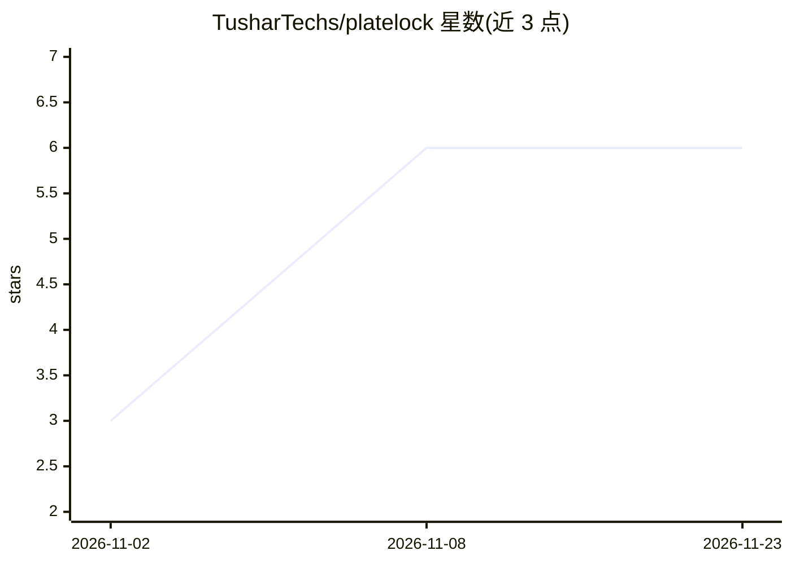

# TusharTechs/platelock

⭐ 6 · Python · MIT · 推送 2026-10-29 · [GitHub](https://github.com/TusharTechs/platelock) · [官网](https://tushartechs.github.io/platelock/) · 个人维护

**ComfyUI 节点包：生成式 VFX 合成时保持原始镜头像素不变**

面向 ComfyUI 的自定义节点包与配套 FastAPI 应用，用于将 LTX-2.3 等视频生成模型的输出以差值蒙版方式合成回原始素材：效果区域外的像素按位复制，输出保留原始分辨率，并提供时间稳定、蒙版精修、保真度报告（bit-identical %、PSNR）等节点。节点为纯 PyTorch 实现，可配合任意 video-to-video 模型输出使用。安装需 GPU 机器运行 ComfyUI 与开放权重模型，应用端可经 SSH 隧道或 Comfy Cloud 接入。

## 筛选速览

| 维度 | 判定 | 备注 |
|---|---|---|
| AI 角色 | `ai-native` | 本体是模型或模型工具 |
| 许可风险 | `permissive` | MIT |
| 部署形态 | `library` | 以包/库形式分发 |
| 模型依赖 | — | README 未给出锁定关系 |
| 硬件要求 | — | 无带数字的原话,不猜 |
| 安装摩擦 | `medium` | 含编译或系统依赖之一 |
| 成熟度 | — | 结构信号不足 |

## 能力要点

- 差值蒙版合成：效果外像素按位复制，输出保留原始分辨率
- 10 个节点覆盖 plate 预处理、蒙版提取、时间稳定、合成与保真度测量
- 节点为纯 PyTorch（CUDA/MPS/CPU），除 ComfyUI 外无额外依赖
- 配套 FastAPI + vanilla-JS 工作室应用，仅通过 Comfy Developer Platform 通信

## 适用场景

- 给实拍镜头添加爆炸、传送门等生成式特效同时保留原始画面
- 把任意 AI 工具生成的视频版本抢救回原始 plate
- 在 Nuke/AE/Resolve 中复用导出的 alpha/emissive 元素与 X-ray 蒙版

## 场景标签

`视频生成` · 领域:内容生成

## 证据(README 行号)

> L7: **Open-source generative VFX for ComfyUI.** LTX-2.3 invents the effect; PlateLock composites it onto your
> L86: The nodes are pure PyTorch (CUDA / MPS / CPU), have no dependencies beyond ComfyUI, and work with **any**
> L92: A FastAPI + vanilla-JS studio that talks to ComfyUI **only through the Comfy Developer Platform**

## 星数曲线

2026-11-02 3 → 2026-11-23 6（+3）

---
*卡片 v1 · prompt 1.4 · 生成 2026-11-20 · 置信度 high · 依据 README sha `9f0508b27085` · [字段定义](../../DATASET.md)*
