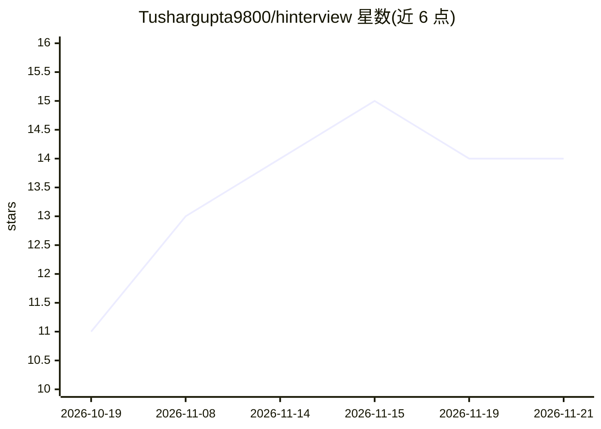

# Tushargupta9800/hinterview

⭐ 14 · TypeScript · 推送 2026-04-06 · [GitHub](https://github.com/Tushargupta9800/hinterview) · 个人维护

**练习 HLD/LLD 系统设计面试的应用：AI 提示与打分**

面向系统设计面试准备者的桌面（Electron）+ Web 应用：提供分阶段题目库（HLD、LLD 或同题混合）、共享画布绘图、本地 SQLite 进度持久化。AI 部分支持多家 provider、本地加密存储 API key，提供提示、答案与评估动作，按 10 分制打分（8 分及格），并支持 AI 美化自定义题目与建议下一阶段。安装运行依赖 npm，包含 React + Vite 前端与 Express + SQLite 后端。

## 筛选速览

| 维度 | 判定 | 备注 |
|---|---|---|
| AI 角色 | `ai-native` | 本体是模型或模型工具 |
| 许可风险 | `none` | — |
| 部署形态 | `library` | 以包/库形式分发 |
| 模型依赖 | — | README 未给出锁定关系 |
| 硬件要求 | — | 无带数字的原话,不猜 |
| 安装摩擦 | `low` | 无编译、无系统依赖或容器化 |
| 成熟度 | — | 结构信号不足 |

## 能力要点

- 分阶段面试题目：HLD/LLD 可同题混合，含阶段锁定与重试
- 多 AI provider 支持，API key 本地加密存储
- AI 提示/答案/评估，10 分制打分（8.00 及格线）
- 共享画布（文本/图形/箭头）与本地 SQLite 持久化

## 适用场景

- 按阶段练习 HLD/LLD 系统设计面试题并获取 AI 打分
- 在共享画布上边画图边接受 AI 提示与评估
- 创建自定义题目并用 AI 美化、建议后续阶段

## 场景标签

 · 领域:教育/面试准备

## 证据(README 行号)

> L16: - AI hints and scoring
> L35: - Score out of `10.00`

## 星数曲线

2026-10-19 11 → 2026-11-21 14（+3）

---
*卡片 v1 · prompt 1.4 · 生成 2026-11-18 · 置信度 mid · 依据 README sha `c72a14f83aad` · [字段定义](../../DATASET.md)*
