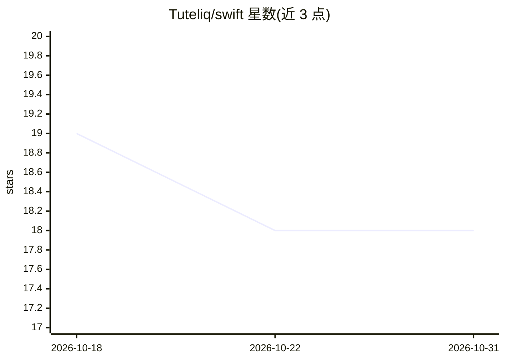

# Tuteliq/swift

⭐ 18 · Swift · MIT · 推送 2026-10-30 · [GitHub](https://github.com/Tuteliq/swift) · [官网](https://tuteliq.ai) · 组织维护

**Tuteliq 儿童安全检测 API 的官方 Swift SDK**

面向 iOS/macOS/tvOS/watchOS/visionOS 开发者的原生 Swift 客户端库，无第三方依赖，采用 async/await 与 Codable 模型。调用 Tuteliq 托管 API 检测文本、语音、图像、视频与 PDF 中的诱骗、霸凌、自残、欺诈与激进化等内容，支持多轮会话风险分析（continuationToken/trajectoryRisk）、合成内容与 deepfake 检测、年龄身份验证会话、webhook、策略规则与审计等平台功能。内置重试退避、类型化错误与 Keychain 存储 API key。通过 Swift Package Manager 安装，需 Swift 5.9+ 与 Tuteliq API key。

## 筛选速览

| 维度 | 判定 | 备注 |
|---|---|---|
| AI 角色 | `ai-ecosystem` | LLM/agent 周边工具 |
| 许可风险 | `permissive` | MIT |
| 部署形态 | `None` |  |
| 模型依赖 | — | README 未给出锁定关系 |
| 硬件要求 | — | 无带数字的原话,不猜 |
| 安装摩擦 | `low` | 无编译、无系统依赖或容器化 |
| 成熟度 | — | 结构信号不足 |

## 能力要点

- 文本/语音/图像/视频/PDF 多模态危害检测（诱骗、霸凌、欺诈、激进化等）
- 多轮会话 continuationToken 与 trajectoryRisk 风险分析
- 合成内容与 deepfake 检测，年龄/身份验证会话
- 自动重试、类型化错误、Keychain 存储 API key，无第三方依赖

## 适用场景

- 在社交或儿童向 App 中接入霸凌与诱骗内容检测
- 对多轮会话做持续风险评级并按 recommendedAction 分级处置
- 检测 AI 生成内容与 deepfake，核验用户年龄身份

## 场景标签

`多模态` `网络安全` · 领域:学习与行业

## 证据(README 行号)

> L5:  Official Swift SDK for the Tuteliq API
> L20: Tuteliq detects grooming, bullying, self-harm, fraud, radicalisation and other harms in text, voice, images, video 

## 星数曲线

2026-10-18 19 → 2026-10-31 18（-1）

---
*卡片 v1 · prompt 1.4 · 生成 2026-10-29 · 置信度 high · 依据 README sha `a826aed62951` · [字段定义](../../DATASET.md)*
