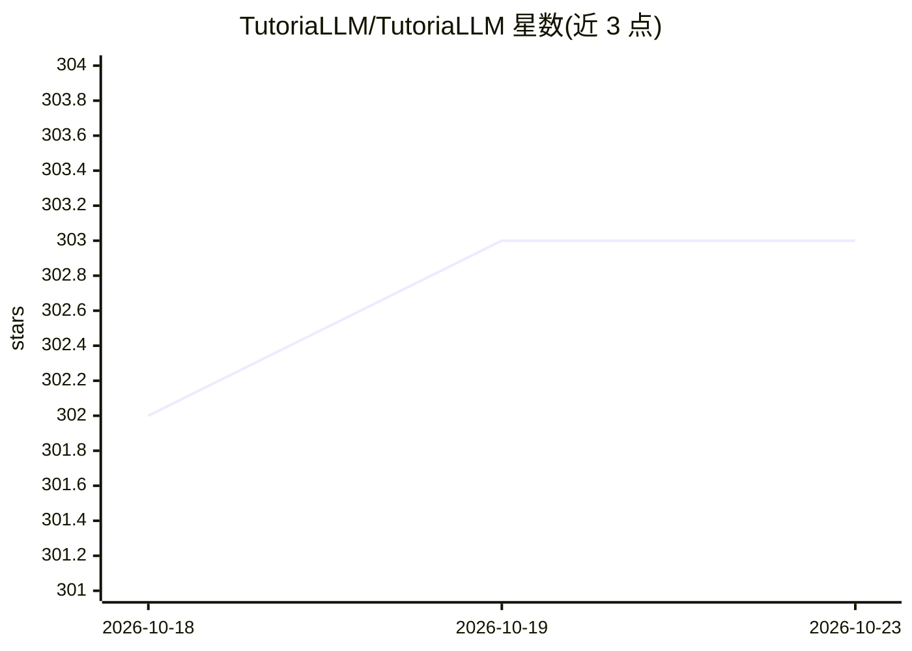

# TutoriaLLM/TutoriaLLM

⭐ 303 · TypeScript · MIT · 推送 2026-10-22 · [GitHub](https://github.com/TutoriaLLM/TutoriaLLM) · [官网](https://tutoriallm.com) · 组织维护

**面向 K-12 的自托管 LLM 编程学习平台**

TutoriaLLM 是可在 Web 上使用的自托管编程学习平台，面向 K-12 教育场景，同时服务教育内容创作者与学习者，由 LLM 提供编程教学功能，界面基于 Blockly 构建。项目提供 Docker 部署方式与 Discord 社区，详细文档与贡献指南托管于官方网站，README 中包含 30 秒介绍视频与 Demo 链接。功能细节与具体 LLM 接入方式在 README 可见范围内未展开。

## 筛选速览

| 维度 | 判定 | 备注 |
|---|---|---|
| AI 角色 | `ai-native` | 本体是模型或模型工具 |
| 许可风险 | `permissive` | MIT |
| 部署形态 | `None` |  |
| 模型依赖 | — | README 未给出锁定关系 |
| 硬件要求 | — | 无带数字的原话,不猜 |
| 安装摩擦 | `low` | 无编译、无系统依赖或容器化 |
| 成熟度 | — | 结构信号不足 |

## 能力要点

- 面向 K-12 教育的 Web 编程学习平台，自托管部署
- 区分教育内容创作者与学习者两类用户
- 基于 Blockly 的可视化编程界面（README 徽标）
- 提供 Docker 部署徽标与官方文档站点

## 适用场景

- 学校或机构自托管搭建 LLM 辅助的编程教学环境
- 教育内容创作者制作编程学习内容
- K-12 学生通过 Web 与 Blockly 学习编程并获得 LLM 指导

## 场景标签

 · 领域:教育/编程学习

## 证据(README 行号)

> L15: TutoriaLLM is a self-hosted programming learning platform for K-12 Education that can be used on the web. It is des

## 星数曲线

2026-10-18 302 → 2026-10-23 303（+1）

---
*卡片 v1 · prompt 1.4 · 生成 2026-10-22 · 置信度 mid · 依据 README sha `0d93acbd2587` · [字段定义](../../DATASET.md)*
