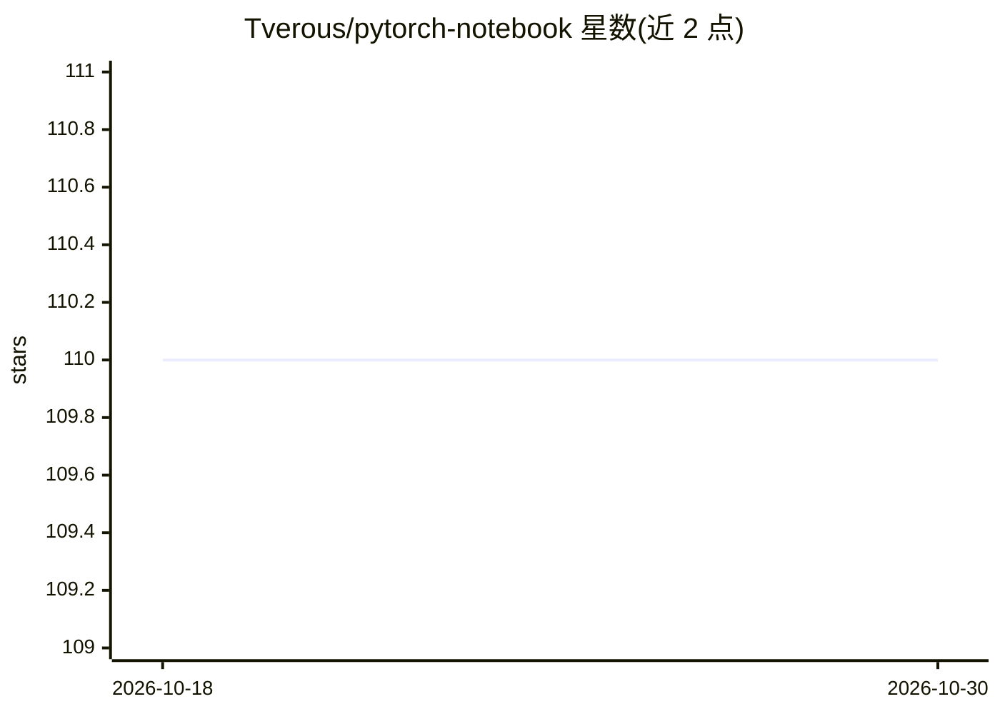

# Tverous/pytorch-notebook

⭐ 110 · Dockerfile · 推送 2026-10-17 · [GitHub](https://github.com/Tverous/pytorch-notebook) · 个人维护

**内置 Jupyter、PyTorch 与 CUDA 支持的 Docker 镜像**

提供预配置的 Docker 镜像，集成 Jupyter Notebook、PyTorch 与 CUDA GPU 支持，面向需要即开即用深度学习开发环境的用户。通过 docker run 启动，支持纯 CPU 与 --gpus all 两种模式，可挂载本地卷；README 另给出实验性构建路径：基于 dockerfile 构建含非 root 用户的镜像、HTTPS 支持镜像及预装 Jupyter Lab 扩展的镜像。访问通过 JUPYTER_TOKEN 或终端日志中的 token 认证。

## 筛选速览

| 维度 | 判定 | 备注 |
|---|---|---|
| AI 角色 | `ai-ecosystem` | LLM/agent 周边工具 |
| 许可风险 | `none` | — |
| 部署形态 | `self-host` | docker 或自建部署 |
| 模型依赖 | — | README 未给出锁定关系 |
| 硬件要求 | — | 无带数字的原话,不猜 |
| 安装摩擦 | `low` | 无编译、无系统依赖或容器化 |
| 成熟度 | — | 结构信号不足 |

## 能力要点

- 单条 docker run 命令启动 CPU 或 GPU（--gpus all）的 Jupyter+PyTorch 环境
- 支持本地卷挂载与远程服务器访问
- 提供非 root 用户、HTTPS、Jupyter Lab 扩展三种扩展构建的 dockerfile

## 适用场景

- 快速获得带 GPU 的 PyTorch 开发环境，免去本机配置
- 远程服务器上运行 Jupyter Notebook 并通过 token 访问
- 按需构建含 HTTPS 或 Jupyter Lab 扩展的定制镜像

## 场景标签

 · 领域:开发环境/容器镜像

## 证据(README 行号)

> L5: This docker image supports with jupyter, pytorch and cuda.
> L22:            --gpus all  \

## 星数曲线

2026-10-18 110 → 2026-10-30 110（+0）

---
*卡片 v1 · prompt 1.4 · 生成 2026-10-23 · 置信度 high · 依据 README sha `242fe57ad04f` · [字段定义](../../DATASET.md)*
