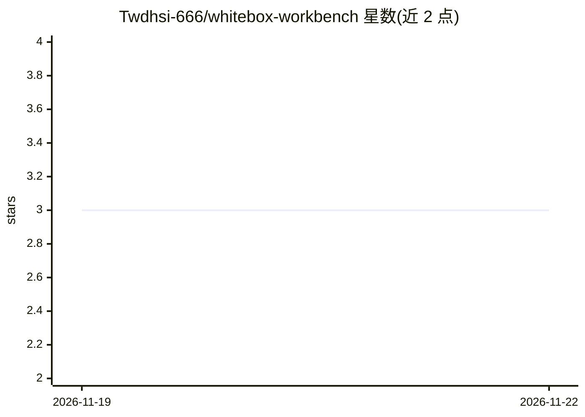

# Twdhsi-666/whitebox-workbench

⭐ 3 · JavaScript · MIT · 推送 2026-10-18 · [GitHub](https://github.com/Twdhsi-666/whitebox-workbench) · [官网](https://twdhsi-666.github.io/whitebox-workbench/) · 个人维护 · 中文 README

**AI 视频制作前用的 3D 白膜搭建与分镜预演工具**

面向 AI 视频创作者的网页端 3D 白膜工作台：v2 内置原生场景编辑器，提供 6 种预设环境、33 个程序化白膜资产、轨道相机、机位与景别管理、localStorage 自动保存；v1 提供 AI 生成白膜 HTML 的导入管理台，按《白膜 HTML 规范 v1.0》校验 manifest 与 10 个标准接口，兼容层用虚拟时钟对旧文件实现播放/暂停/跳转/截图。Three.js 本地镜像、零构建零上传，支持双击启动脚本、在线版或命令行本地服务器运行。

## 筛选速览

| 维度 | 判定 | 备注 |
|---|---|---|
| AI 角色 | `ai-enhanced` | 去掉 AI 部分产品仍成立 |
| 许可风险 | `permissive` | MIT |
| 部署形态 | `None` |  |
| 模型依赖 | — | README 未给出锁定关系 |
| 硬件要求 | — | 无带数字的原话,不猜 |
| 安装摩擦 | `low` | 无编译、无系统依赖或容器化 |
| 成熟度 | — | 结构信号不足 |

## 能力要点

- 6 种预设环境 + 33 个程序化白膜资产，无需写代码搭镜头
- 导入 AI 生成的白膜 HTML，统一播放/跳转/逐帧截图
- 兼容层通过虚拟时钟接管旧文件的播放/暂停/跳转（0.1s 精度）
- 内置规范文档与一键复制 AI 提示词，支持导出/导入项目 JSON

## 适用场景

- 拍 AI 视频前先搭白膜场景、预演镜头逻辑
- 把不同 AI 生成的白膜 HTML 收进一个场景库统一管理
- 给模型生成场景前，用编辑器快速产出参考分镜

## 场景标签

 · 领域:视频制作/创意工具

## 证据(README 行号)

> L7: 解决什么问题：用 HTML 做 3D 白膜来理顺 AI 视频的镜头逻辑，成本极低、语言模型也能生成——但每个 AI 产出的 HTML 格式都不一样，无法统一控制。本工作台定义了一份**《白膜 HTML 规范 v1.0》**，并内置*
> L64: 把 `spec/AI提示词.md` 整段复制，连同你的场景需求发给任意 AI（DeepSeek / ChatGPT / Claude / 通义……），它返回的 HTML 就能直接拖进工作台。

## 星数曲线

2026-11-19 3 → 2026-11-22 3（+0）

---
*卡片 v1 · prompt 1.4 · 生成 2026-11-22 · 置信度 high · 依据 README sha `e5d71dc6e6bb` · [字段定义](../../DATASET.md)*
