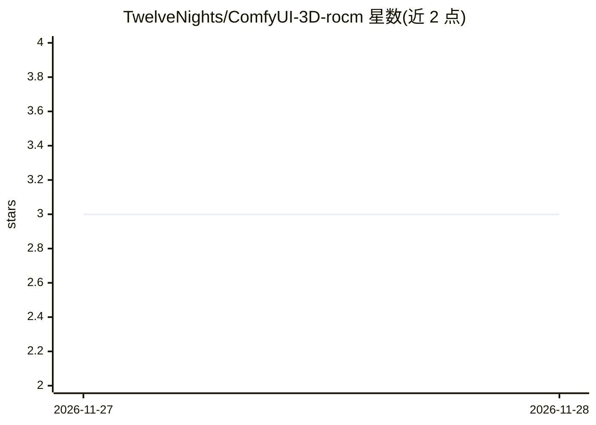

# TwelveNights/ComfyUI-3D-rocm

⭐ 3 · Python · Apache-2.0 · 推送 2026-11-22 · [GitHub](https://github.com/TwelveNights/ComfyUI-3D-rocm) · [官网](https://registry.comfy.org/nodes/comfyui-3d-rocm) · 个人维护

**AMD GPU 上在 ComfyUI 内图生带 PBR 纹理 3D 资产的节点包**

面向 ComfyUI 的自定义节点包，将 TripoSG 图生网格与 Hunyuan3D-2.1 PBR 纹理绘制以 ROCm 兼容节点形式提供，支持 Radeon 与 Instinct GPU（Windows/Linux）。通过 PyTorch/NumPy 重写替代 CUDA/C++ 扩展，无需编译；输出 GLB（含 base color、metallic、roughness 贴图）。需 ComfyUI 0.34+ 与 ROCm PyTorch，16 GB 显存即可，模型约占 26 GB 磁盘；可选 SageAttention-rocm 加速。经 ComfyUI Manager 或 git clone 安装。

## 筛选速览

| 维度 | 判定 | 备注 |
|---|---|---|
| AI 角色 | `ai-native` | 本体是模型或模型工具 |
| 许可风险 | `permissive` | Apache-2.0 |
| 部署形态 | `desktop` | 安装包/桌面程序 |
| 模型依赖 | — | README 未给出锁定关系 |
| 硬件要求 | `gpu-8g` | |
| 安装摩擦 | `medium` | 含编译或系统依赖之一 |
| 成熟度 | — | 结构信号不足 |

## 能力要点

- TripoSG image-to-mesh 与 Hunyuan3D-2.1 PBR 纹理节点，无 CUDA/C++ 扩展、无需编译
- 可对任意 ComfyUI MESH（含原生 Hunyuan3D-2.1 形状节点）做纹理绘制
- 峰值显存约 10 GiB，16 GB 显卡可用；输出 GLB 供 Blender/Godot/Unity 使用
- 可选 SageAttention-rocm 8-bit attention 加速

## 适用场景

- 在 AMD 显卡上从单张图片生成带 PBR 贴图的 3D 资产
- 为游戏引擎（Godot/Unity/Blender）准备 GLB 模型素材
- 在 ComfyUI 工作流中给其他生成器产出的网格加纹理

## 场景标签

 · 领域:图像生成 3D 资产/内容创作工具

## 证据(README 行号)

> L3: Image to textured 3D asset in ComfyUI on AMD GPUs: TripoSG
> L5: ComfyUI nodes, on Radeon and Instinct GPUs, Linux and Windows. No CUDA or C++ extensions, no Blender, nothing to
> L33: 1. **Install the node pack.** In ComfyUI Manager open *Custom Nodes Manager*, search for **rocm**, install

## 星数曲线

2026-11-27 3 → 2026-11-28 3（+0）

---
*卡片 v1 · prompt 1.4 · 生成 2026-11-27 · 置信度 mid · 依据 README sha `59437344bec8` · [字段定义](../../DATASET.md)*
