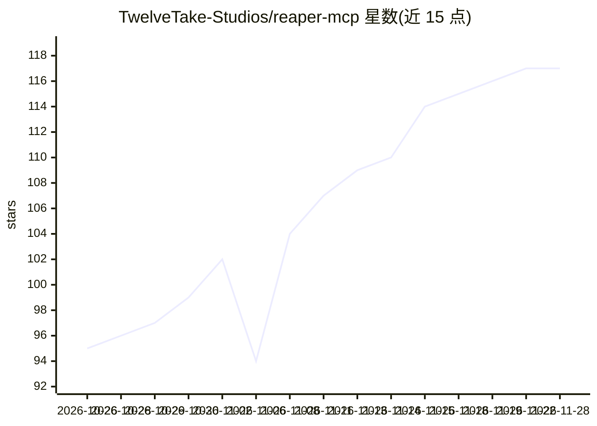

# TwelveTake-Studios/reaper-mcp

⭐ 117 · Python · MIT · 推送 2026-11-09 · [GitHub](https://github.com/TwelveTake-Studios/reaper-mcp) · [官网](https://twelvetake.com) · 组织维护

**MCP server：让 AI 助手控制 REAPER 完成混音、母带与 MIDI 制作**

模型上下文协议（MCP）服务器，使 MCP 兼容的 AI 助手通过 Lua 桥接脚本控制 REAPER，提供 188 个工具，覆盖轨道操作、FX 插件与参数自动化、路由与侧链、包络自动化、MIDI 编写与编辑、音频项处理、响度/真峰测量等；另含侧链压缩、母带链、并行压缩等单次调用完成多步任务的工作流工具。通信基于文件邮箱机制，无需网络配置；每次 AI 修改在 REAPER 撤销历史中为一步可撤销操作。要求 REAPER、Python 3.10+ 与 MCP 兼容助手。

## 筛选速览

| 维度 | 判定 | 备注 |
|---|---|---|
| AI 角色 | `ai-ecosystem` | LLM/agent 周边工具 |
| 许可风险 | `permissive` | MIT |
| 部署形态 | `library` | 以包/库形式分发 |
| 模型依赖 | — | README 未给出锁定关系 |
| 硬件要求 | — | 无带数字的原话,不猜 |
| 安装摩擦 | `low` | 无编译、无系统依赖或容器化 |
| 成熟度 | — | 结构信号不足 |

## 能力要点

- 188 个工具覆盖轨道、FX、路由、自动化、MIDI、测量等制作环节
- 侧链压缩/母带链/并行压缩等多步任务单次调用完成
- 基于文件的桥接通信，无需网络配置与端口
- 全部修改计入 REAPER 撤销历史，可逐步撤销

## 适用场景

- 用自然语言指挥 AI 助手完成混音与轨道操作
- 让 AI 生成并编辑 MIDI 音符与和弦
- 用 AI 配置母带链并测量响度、真峰

## 场景标签

 · 领域:音乐制作/工具集成

## 证据(README 行号)

> L13: TwelveTake REAPER MCP is a Model Context Protocol server that enables AI assistants to control REAPER for mixing, m
> L61: - An MCP-compatible AI assistant
> L44: - **MIDI** — create items, add notes individually or in batches, edit velocities

## 星数曲线

2026-10-26 95 → 2026-11-28 117（+22）

---
*卡片 v1 · prompt 1.4 · 生成 2026-11-28 · 置信度 high · 依据 README sha `b88f27f522ee` · [字段定义](../../DATASET.md)*
