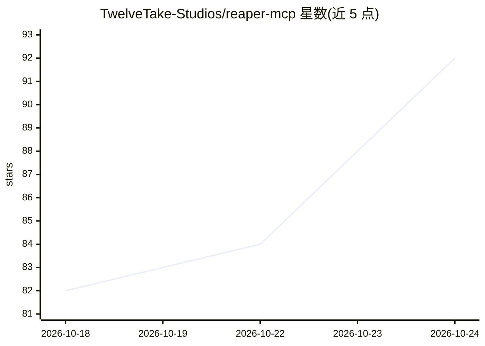

# TwelveTake-Studios/reaper-mcp

⭐ 94 · Python · MIT · 推送 2026-10-21 · [GitHub](https://github.com/TwelveTake-Studios/reaper-mcp) · [官网](https://twelvetake.com) · 组织维护

**让 AI 助手通过 MCP 控制 REAPER 音乐制作的服务器**

Model Context Protocol 服务器，供 MCP 兼容的 AI 助手操作 REAPER 数字音频工作站，覆盖混音、母带处理与 MIDI 作曲：提供约 180 个工具，包括轨道/FX/路由/自动化/MIDI 编辑/标记区域操作，以及侧链压缩、母带链、并行压缩等一步完成的多步工作流工具，并含通过 EBU 合规信号的响度/真峰值等测量。通信采用文件邮箱目录方式（JSON 文件交换），无需网络配置；REAPER 端仅需 Lua 桥接脚本与 JSFX 分析插件。需 REAPER、Python 3.10+ 与 MCP 客户端；PyPI 发布为 twelvetake-reaper-mcp。

## 筛选速览

| 维度 | 判定 | 备注 |
|---|---|---|
| AI 角色 | `ai-ecosystem` | LLM/agent 周边工具 |
| 许可风险 | `permissive` | MIT |
| 部署形态 | `library` | 以包/库形式分发 |
| 模型依赖 | — | README 未给出锁定关系 |
| 硬件要求 | — | 无带数字的原话,不猜 |
| 安装摩擦 | `low` | 无编译、无系统依赖或容器化 |
| 成熟度 | — | 结构信号不足 |

## 能力要点

- 约 180 个工具覆盖轨道、FX 参数、路由、自动化、MIDI 编辑与音频条目操作
- 一步式工作流工具：侧链压缩、母带链（ReaEQ→ReaComp→ReaEQ→ReaLimit）、并行压缩
- 响度/真峰值/响度范围/倍频程频谱测量，通过 EBU 合成合规信号
- 文件邮箱通信无需网络配置；AI 的每次修改对应 REAPER 撤销历史中的单个命名步骤

## 适用场景

- 用对话指令让 AI 助手完成混音与母带处理操作
- 通过自然语言进行 MIDI 作曲与音符编辑
- 让 AI 读取项目摘要并做响度/峰值测量分析

## 场景标签

 · 领域:音乐制作/AI 工具集成

## 证据(README 行号)

> L13: TwelveTake REAPER MCP is a Model Context Protocol server that enables AI assistants to control REAPER for mixing, m
> L59: - An MCP-compatible AI assistant
> L247: The server and the bridge exchange JSON files in a mailbox directory that the bridge script

## 星数曲线

2026-10-18 82 → 2026-10-24 92（+10）

---
*卡片 v1 · prompt 1.4 · 生成 2026-10-24 · 置信度 high · 依据 README sha `dafd130d711d` · [字段定义](../../DATASET.md)*
