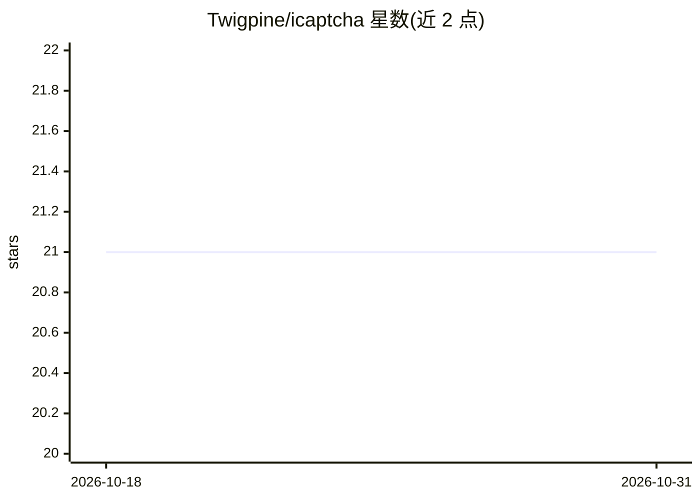

# Twigpine/icaptcha

⭐ 21 · TypeScript · MIT · 推送 2026-10-12 · [GitHub](https://github.com/Twigpine/icaptcha) · [官网](https://icaptcha.gitlawb.com) · 组织维护

**给服务端开发者的反机器人门：验证请求者是智能体而非脚本**

面向服务运营方的 proof-of-intelligence 验证服务，与业务领域无关，可部署在任意端点前。机制：向请求者发放代数、数列、字谜、逻辑题等挑战，答错即提升难度直至通过或耗尽尝试次数；状态以 AES-256-GCM token 封存于客户端，服务端无会话存储可水平扩展；通过后签发 Ed25519 签名证明，任意服务可凭公开密钥离线验证。限制：对自带模型的攻击者非绝对屏障，消费方仍需保留配额与限速。提供托管 HTTP API 与 npm 包（含进程内 Engine），LLM 题型需配置 OPENGATEWAY。

## 筛选速览

| 维度 | 判定 | 备注 |
|---|---|---|
| AI 角色 | `ai-enhanced` | 去掉 AI 部分产品仍成立 |
| 许可风险 | `permissive` | MIT |
| 部署形态 | `None` |  |
| 模型依赖 | — | README 未给出锁定关系 |
| 硬件要求 | — | 无带数字的原话,不猜 |
| 安装摩擦 | `low` | 无编译、无系统依赖或容器化 |
| 成熟度 | — | 结构信号不足 |

## 能力要点

- 答错递增难度的挑战-应答机制（7 类题型，5 类确定性判分无需网络）
- AES-256-GCM 无状态 token，服务端零会话可水平扩展
- Ed25519 签名证明，任意服务可离线验证（/v1/pubkey 公钥）
- 提供 npm 包 @gitlawb/icaptcha，可进程内运行 Engine

## 适用场景

- 在 agent 平台端点前拦截脚本化批量注册或垃圾请求
- 为面向 AI agent 的服务签发可跨服务离线核验的智能证明
- 按等级要求对请求者施加逐请求推理成本

## 场景标签

`网络安全` · 领域:学习与行业

## 证据(README 行号)

> L11: A classic CAPTCHA proves "I'm a human, not a bot." iCaptcha proves the opposite:
> L27: automation, iCaptcha filters out automation that **cannot reason**. A capable

## 星数曲线

2026-10-18 21 → 2026-10-31 21（+0）

---
*卡片 v1 · prompt 1.4 · 生成 2026-10-28 · 置信度 high · 依据 README sha `b0ef204611cb` · [字段定义](../../DATASET.md)*
