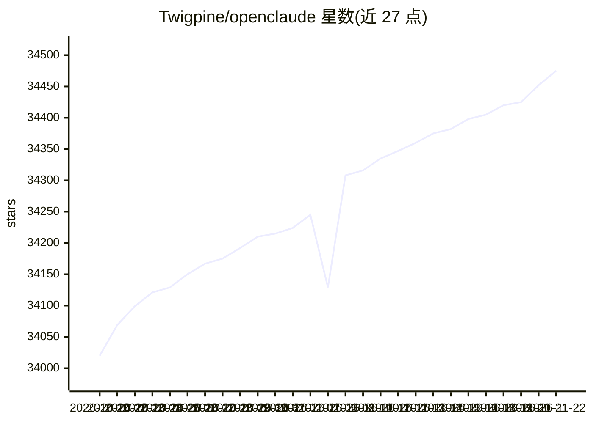

# Twigpine/openclaude

⭐ 34,475 · TypeScript · NOASSERTION · 推送 2026-11-21 · [GitHub](https://github.com/Twigpine/openclaude) · [官网](https://openclaude.twigpine.com) · 组织维护

**开源终端编码 Agent CLI：一个入口接入云与本地多种模型后端**

面向终端的编码 Agent 命令行工具，可在同一终端工作流中调用 OpenAI 兼容 API、Gemini、GitHub Models、Codex OAuth、Ollama、Atomic Chat 等后端。功能覆盖 bash 与文件工具、grep/glob、子 Agent、任务、MCP、斜杠命令、流式输出、会话恢复/分叉/管理、后台会话（含 ps/wait/logs/attach/agents 子命令）以及网页搜索后端选择。通过 /provider 做引导式供应商配置并保存凭据 profile；不自动读取项目 .env，不读取 .claude 配置目录，无需安装 Claude Code。安装方式为 npm 全局包与 AUR 包，运行需 Node.js >=24.22.1。

## 筛选速览

| 维度 | 判定 | 备注 |
|---|---|---|
| AI 角色 | `ai-ecosystem` | LLM/agent 周边工具 |
| 许可风险 | `none` | NOASSERTION |
| 部署形态 | `library` | 以包/库形式分发 |
| 模型依赖 | local-ok | 支持本地模型 |
| 硬件要求 | — | 无带数字的原话,不猜 |
| 安装摩擦 | `low` | 无编译、无系统依赖或容器化 |
| 成熟度 | — | 结构信号不足 |

## 动量与使用信号

- 维护:`active` — 距上次 push 3.3 天,年发版 45,160 位贡献者
- 涨星:近 1 天 **+33**(自 20261016 起算)
- 安装:npm 包 `@twigpine/openclaude` 月下载 1,322
- 平台:— · 协议:OPENAI-API / MCP / OLLAMA

## 能力要点

- 单一 CLI 接入云 API 与本地模型后端（OpenAI 兼容、Gemini、GitHub Models、Ollama 等）
- 编码 Agent 工作流：bash、文件工具、grep/glob、agents、tasks、MCP、web 工具
- 后台会话管理与等待/日志/派发子命令，适用于脚本与 CI
- 捆绑 VS Code 扩展与 /provider 引导式供应商配置

## 适用场景

- 在终端里用统一工作流切换云与本地模型做编码任务
- 在 CI 脚本中运行并等待非交互的后台 Agent 任务
- 用 MCP、斜杠命令和子 Agent 组织自己的编码工作流

## 场景标签

`编码 Agent` · 领域:编码与开发

## 证据(README 行号)

> L7: OpenClaude is an open-source coding-agent CLI for cloud and local model providers.
> L9: Use OpenAI-compatible APIs, Gemini, GitHub Models, Codex OAuth, Codex, Ollama, Atomic Chat, and other supported back
> L103: - Coding-agent workflows in one place: bash, file tools, grep, glob, agents, tasks, MCP, and web tools

## 星数曲线

2026-10-20 34,020 → 2026-11-22 34,475（+455）

---
*卡片 v1 · prompt 1.4 · 生成 2026-11-22 · 置信度 high · 依据 README sha `aed6b72866d9` · [字段定义](../../DATASET.md)*
