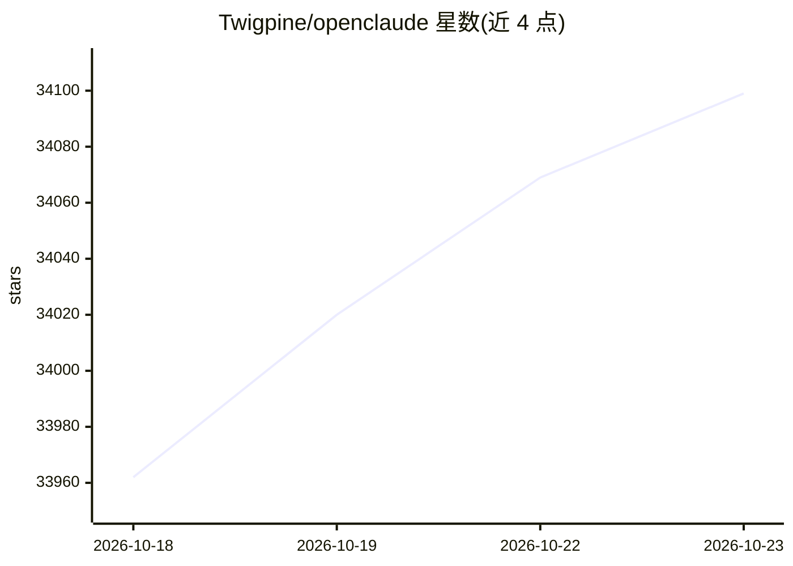

# Twigpine/openclaude

⭐ 34,099 · TypeScript · NOASSERTION · 推送 2026-10-22 · [GitHub](https://github.com/Twigpine/openclaude) · [官网](https://openclaude.twigpine.com) · 组织维护

**面向开发者的多后端编码 agent CLI，统一终端工作流**

OpenClaude 是一个开源编码 agent CLI，通过一套终端工作流接入云 API 与本地模型后端：支持 prompts、工具调用、agents、MCP、slash 命令与流式输出。通过 /provider 命令做引导式后端配置并保存 profile，凭证存于 .openclaude-profile.json；不自动加载项目 .env，需显式导出或使用 --provider-env-file。会话支持恢复、分叉（仅对话分支，无文件系统隔离）、后台运行（本地子进程，无 daemon）。需 Node.js >=22；配置独立于 Claude Code 存储。

## 筛选速览

| 维度 | 判定 | 备注 |
|---|---|---|
| AI 角色 | `ai-native` | 本体是模型或模型工具 |
| 许可风险 | `none` | NOASSERTION |
| 部署形态 | `library` | 以包/库形式分发 |
| 模型依赖 | local-ok | 支持本地模型 |
| 硬件要求 | — | 无带数字的原话,不猜 |
| 安装摩擦 | `low` | 无编译、无系统依赖或容器化 |
| 成熟度 | — | 结构信号不足 |

## 动量与使用信号

- 维护:`active` — 距上次 push 3.3 天,年发版 45,160 位贡献者
- 涨星:近 1 天 **+33**(自 20261016 起算)
- 安装:npm 包 `@twigpine/openclaude` 月下载 1,322
- 平台:— · 协议:OPENAI-API / MCP / OLLAMA

## 能力要点

- 单一 CLI 接入 OpenAI 兼容 API、Gemini、GitHub Models、Codex OAuth、Ollama 等后端
- /provider 引导式配置与 profile 保存，支持多个网关型服务商的专属通道
- 后台会话管理：--bg 运行、ps/logs/kill 进程管理
- 内置 bash、文件工具、grep/glob、agents、tasks、MCP 与 web 工具，附带 VS Code 扩展

## 适用场景

- 用一套 CLI 在云端 API 与本地 Ollama 模型之间切换编码 agent 工作流
- 在终端运行长时间后台编码任务并管理会话
- 通过多个网关服务商使用 DeepSeek、Qwen 等模型

## 场景标签

`编码 Agent` · 领域:编码与开发

## 证据(README 行号)

> L7: OpenClaude is an open-source coding-agent CLI for cloud and local model providers.
> L9: Use OpenAI-compatible APIs, Gemini, GitHub Models, Codex OAuth, Codex, Ollama, Atomic Chat, and other supported back
> L103: - Coding-agent workflows in one place: bash, file tools, grep, glob, agents, tasks, MCP, and web tools

## 星数曲线

2026-10-18 33,962 → 2026-10-23 34,099（+137）

---
*卡片 v1 · prompt 1.4 · 生成 2026-10-18 · 置信度 high · 依据 README sha `ed8dfb78f3df` · [字段定义](../../DATASET.md)*
