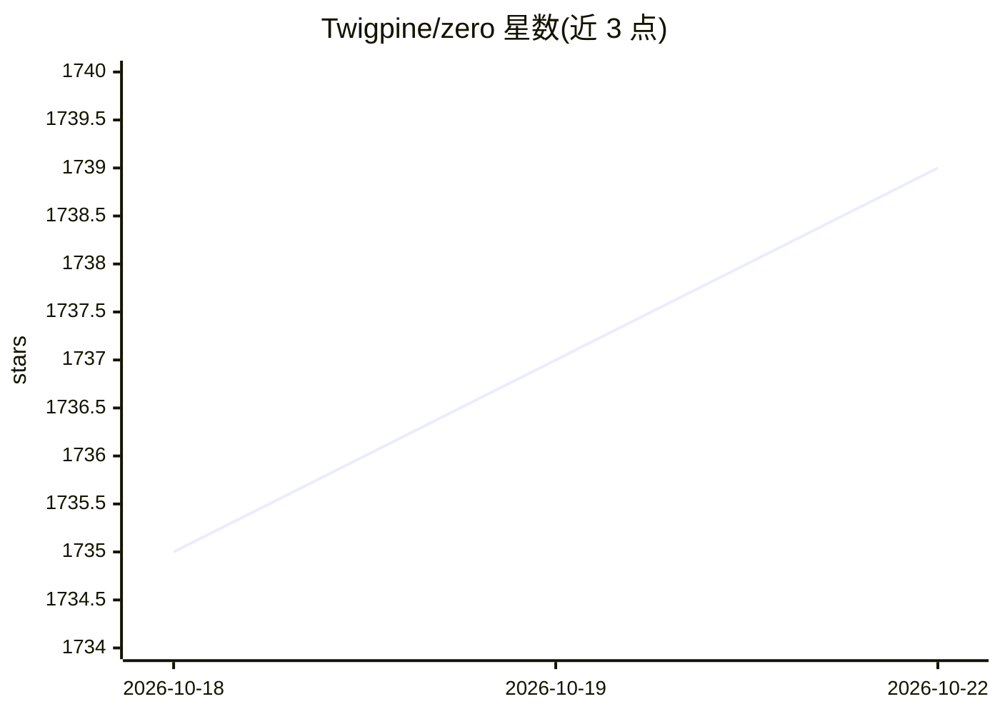

# Twigpine/zero

⭐ 1,739 · Go · MIT · 推送 2026-10-21 · [GitHub](https://github.com/Twigpine/zero) · [官网](https://zero.twigpine.com) · 组织维护 · 中文 README

**本地终端 AI 编程代理：自选模型与权限自主执行编码任务**

Go 编写的终端编程代理，可检查仓库、编辑文件、运行命令、调用浏览器/终端辅助工具，会话本地持久化且不上传遥测。支持 25+ 模型接入（OpenAI、Anthropic、Gemini、Ollama、LM Studio 或任意 OpenAI/Anthropic 兼容端点），文件写入、shell 命令与网络访问经权限与沙箱策略控制。提供交互式 TUI 与可脚本化的 zero exec（stream-JSON 输入输出、隔离 worktree、CI 退出码），支持 MCP、插件、hooks、子代理与 markdown 技能扩展。Linux 沙箱需 Bubblewrap。

## 筛选速览

| 维度 | 判定 | 备注 |
|---|---|---|
| AI 角色 | `ai-native` | 本体是模型或模型工具 |
| 许可风险 | `permissive` | MIT |
| 部署形态 | `desktop` | 安装包/桌面程序 |
| 模型依赖 | local-ok | 支持本地模型 |
| 硬件要求 | — | 无带数字的原话,不猜 |
| 安装摩擦 | `low` | 无编译、无系统依赖或容器化 |
| 成熟度 | — | 结构信号不足 |

## 能力要点

- TUI + 无头 exec 双模式，stream-JSON 可编程接口
- 文件写入/shell/网络均经权限门控与沙箱策略，密钥从输出中脱敏
- 会话本地存储、可搜索可恢复，Zero 不上传遥测
- MCP、插件、hooks、skills、子代理扩展机制

## 适用场景

- 在终端里让 AI 代理改代码、修测试并跑命令
- CI 中用 zero exec 做可脚本化的自动化编码任务
- 用本地 Ollama/LM Studio 模型完成编程任务，数据不出本机

## 场景标签

`编码 Agent` · 领域:编码与开发

## 证据(README 行号)

> L16: Zero is an AI coding agent for your local terminal. It can inspect a repository,
> L22: zero exec "fix the failing test in ./pkg"

## 星数曲线

2026-10-18 1,735 → 2026-10-22 1,739（+4）

---
*卡片 v1 · prompt 1.4 · 生成 2026-10-21 · 置信度 high · 依据 README sha `88dd18419931` · [字段定义](../../DATASET.md)*
