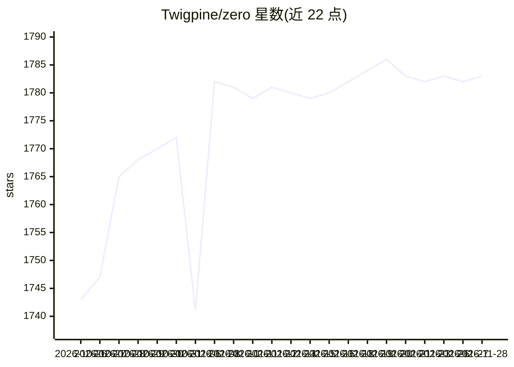

# Twigpine/zero

⭐ 1,783 · Go · MIT · 推送 2026-11-24 · [GitHub](https://github.com/Twigpine/zero) · [官网](https://zero.twigpine.com) · 组织维护

**本地终端 AI 编码代理：自选模型与权限策略**

面向本地终端的编码代理 CLI，可检查仓库、编辑文件、运行命令、使用浏览器/终端助手，并保存可搜索、可恢复的本地会话。用户自选模型与提供商（OpenAI、Anthropic、Gemini、Ollama、LM Studio 等及任意 OpenAI/Anthropic 兼容端点），文件写入、shell 命令、网络访问均经权限与沙箱策略管控；支持 TUI 交互模式与可脚本化的 `zero exec` 无头模式（文本/JSON/stream-JSON I/O、隔离 worktree、CI 退出码），并可扩展 MCP 服务器、技能、插件、hooks 与子代理。以 npm 包、安装脚本或 Go 源码构建分发。

## 筛选速览

| 维度 | 判定 | 备注 |
|---|---|---|
| AI 角色 | `ai-native` | 本体是模型或模型工具 |
| 许可风险 | `permissive` | MIT |
| 部署形态 | `desktop` | 安装包/桌面程序 |
| 模型依赖 | local-ok | 支持本地模型 |
| 硬件要求 | — | 无带数字的原话,不猜 |
| 安装摩擦 | `low` | 无编译、无系统依赖或容器化 |
| 成熟度 | — | 结构信号不足 |

## 能力要点

- 多提供商接入：25+ 提供商及任意 OpenAI/Anthropic 兼容端点，含 Ollama/LM Studio 本地模型
- 权限与沙箱策略：写入范围、shell、网络访问受控，Linux 沙箱基于 Bubblewrap
- TUI 与无头 exec 双模式，支持 stream-JSON 协议与 CI 集成
- 本地会话存储于磁盘，可搜索、恢复、fork，不上传遥测

## 适用场景

- 在终端里让 AI 代理修复失败的测试或重构代码
- 在 CI 中以 stream-JSON 方式脚本化运行编码任务
- 用本地模型（Ollama/LM Studio）在离线环境运行编码代理
- 通过 MCP 服务器、skills 和 hooks 扩展代理工具集

## 场景标签

`编码 Agent` · 领域:编码与开发

## 证据(README 行号)

> L17: Zero is an AI coding agent for your local terminal. It can inspect a repository,
> L80: - **Use the model you want.** Bring OpenAI, Anthropic, Gemini, Groq, OpenRouter,

## 星数曲线

2026-10-26 1,743 → 2026-11-28 1,783（+40）

---
*卡片 v1 · prompt 1.4 · 生成 2026-11-24 · 置信度 mid · 依据 README sha `e87c23c6d300` · [字段定义](../../DATASET.md)*
